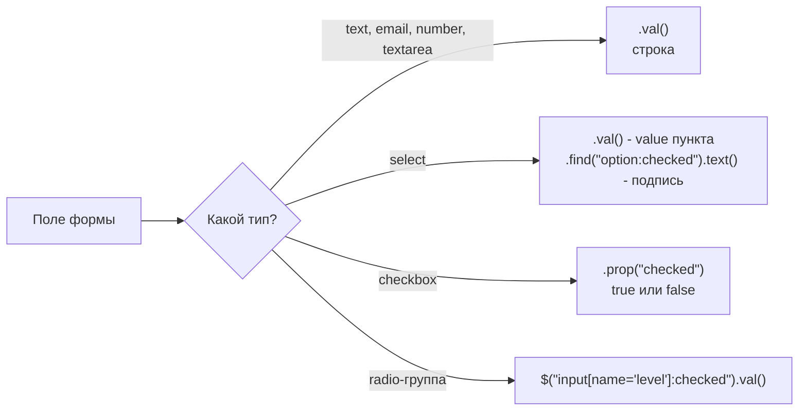
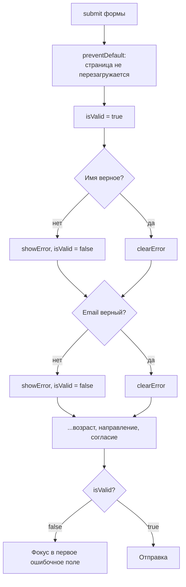
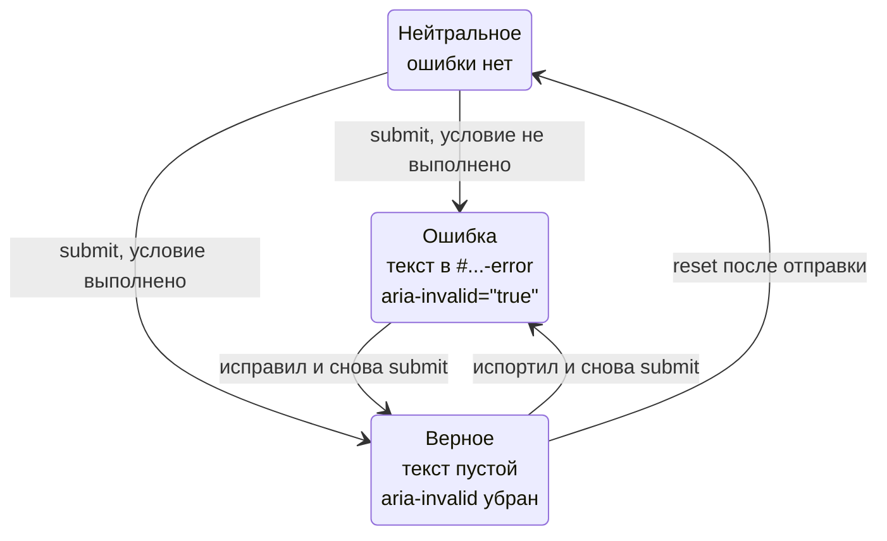
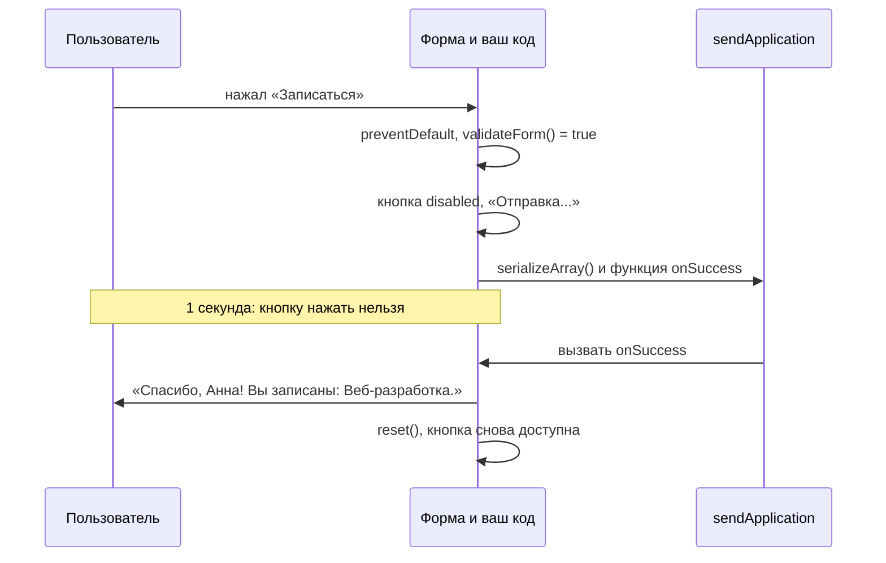

# Формы

[Содержание](../../README.md) · [← Назад](../../Lesson-7/ru/%D0%AD%D1%84%D1%84%D0%B5%D0%BA%D1%82%D1%8B%20%D0%B8%20%D0%B0%D0%BD%D0%B8%D0%BC%D0%B0%D1%86%D0%B8%D1%8F.md) · [Вперёд →](../../Lesson-9/ru/AJAX%20-%20%D0%B7%D0%B0%D0%B3%D1%80%D1%83%D0%B7%D0%BA%D0%B0%20%D0%B4%D0%B0%D0%BD%D0%BD%D1%8B%D1%85.md) · [RU](%D0%A4%D0%BE%D1%80%D0%BC%D1%8B.md) · [EN](../en/Forms.md) · [UZ](../uz/Formalar.md)

> **Связь с уроком 7:** вы научились плавно показывать и прятать элементы, а в уроке 6 - подписываться на события и отменять действие браузера. Сегодня соберём всё вместе на самом важном элементе сайта - **форме**: прочитаем все поля, проверим их, покажем ошибки рядом с полями и аккуратно «отправим» заявку.

---

## Зачем это вам

Представьте: в университете открывается кружок программирования, и запись идёт через форму на сайте. Абитуриент забыл email - и узнаёт об этом только после перезагрузки, когда всё введённое пропало. Или нажал «Записаться» три раза, потому что ничего не происходило, - и в списке три одинаковые заявки. Или видит «Ошибка в форме», но не понимает, какое поле неверно.

Хорошая форма сразу и рядом с полем подсказывает, что исправить, не теряет введённое, блокирует кнопку на время отправки и после успеха очищается. Почти на каждом сайте с jQuery есть такие формы: запись, обратная связь, заказ, регистрация. В курсе JavaScript вы уже делали проверку на чистом JS - сегодня то же самое станет короче, а данные формы будут собираться **одним вызовом**.

---

## Чему вы научитесь

- Обрабатывать отправку формы через `.on("submit", ...)` без перезагрузки страницы.
- Читать значения текстовых полей, чисел и списков `<select>`: `.val()`.
- Узнавать состояние флажков и переключателей: `.prop("checked")`, `:checked`, `.is()`.
- Собирать все данные формы одним вызовом: `.serialize()` и `.serializeArray()`.
- Показывать **все** ошибки сразу рядом с полями и помечать их для читалок: `aria-invalid`.
- Блокировать кнопку на время отправки и сбрасывать форму после успеха.

---

## Повторение: 3 вопроса из урока 7

1. Чем `.hide()` отличается от `.fadeOut(400)`? Что у них общего в конце?
2. Зачем передавать функцию завершения: `$box.fadeOut(400, function () { ... })`?
3. Что делает `$.fx.off = true` и кому это нужно?

Ответы - в конце урока.

---

## План урока

| Раздел | Что делаем |
| --- | --- |
| Форма и событие `submit` | Перехватить отправку без перезагрузки |
| Значения полей | `.val()` у текста, чисел и списков |
| Флажки и переключатели | `.prop("checked")` и `:checked` |
| Мини-задание 1 | Страница настроек профиля |
| Все данные формы сразу | `.serialize()` и `.serializeArray()` |
| Проверка полей | Правила, все ошибки сразу |
| Ошибки рядом с полем | `aria-invalid`, `aria-describedby`, фокус |
| Отправка | Блокировка кнопки, ответ «сервера», сброс |
| Мини-задание 2 | Форма подписки |
| Самостоятельная работа | Форма записи в кружок |

---

## Форма и событие `submit`

### Где ловить отправку

**Простыми словами:** форма - это бланк заявления, а событие `submit` - момент, когда человек отдаёт бланк в окошко. Неважно, как он это сделал: протянул рукой (кнопка) или попросил соседа (клавиша Enter в поле). Поэтому караулить нужно у окошка - **на форме**, а не на кнопке.

```html
<form id="signup-form" novalidate>
    <label for="name">Имя</label>
    <input id="name" name="name" type="text">
    <button type="submit">Записаться</button>
</form>
```

```js
const $form = $("#signup-form");

$form.on("submit", function (event) {
    event.preventDefault();             // не перезагружать страницу
    console.log("Форма отправлена");
});
```

| Чистый JavaScript (курс JS, урок 9) | jQuery |
| --- | --- |
| `form.addEventListener("submit", (event) => { ... })` | `$form.on("submit", function (event) { ... })` |
| `event.preventDefault()` | `event.preventDefault()` - тот же метод |

### Зачем `preventDefault`

Без него браузер выполнит действие по умолчанию: отправит данные по адресу из `action` (или на ту же страницу) и **перезагрузит** её. Все ваши сообщения и введённые данные исчезнут. Вы уже встречали `preventDefault` в уроке 6 со ссылками - здесь то же самое.

> **Важно:** вызывайте `event.preventDefault()` **первой строкой** обработчика - до проверок. Если ниже случится ошибка в коде, страница хотя бы не перезагрузится и вы увидите сообщение в консоли.

В старом коде вы встретите `$form.submit(function () { ... })` - это сокращение устарело, как и `.click(fn)` из урока 6. Вызвать отправку из кода можно через `$form.trigger("submit")`: сработают ваши обработчики, а если ни один не вызвал `preventDefault`, браузер отправит форму.

### Атрибут `novalidate`

Атрибуты `required`, `type="email"`, `min` и `max` заставляют браузер проверять форму сам и показывать свои подсказки - у каждого браузера разные. `novalidate` у `<form>` отключает их: проверку и тексты ошибок делает **ваш** код. Атрибуты `type` и `required` оставьте - они описывают смысл поля.

---

## Значения полей: `.val()`

`.val()` вы знаете по уроку 3. В формах он главный инструмент, поэтому разберём, что он возвращает у разных полей.

```html
<input id="age" name="age" type="number">
<select id="direction" name="direction">
    <option value="">Выберите направление</option>
    <option value="web">Веб-разработка</option>
    <option value="python">Python для начинающих</option>
</select>
```

| Поле | `.val()` вернёт | Пример |
| --- | --- | --- |
| `<input type="text">` | Набранный текст | `" Анна "` - с пробелами, как ввели |
| `<input type="number">` | **Строку** с числом или `""` | `"20"`, а не `20` |
| `<select>` | `value` выбранного `<option>` | `"web"`, а не «Веб-разработка» |

### Число из поля - всегда строка

```js
const age = Number($("#age").val());   // "20" → 20
console.log(age + 1);                   // 21, а без Number было бы "201"
```

В поле `type="number"` браузер не даст ввести буквы, но пустое поле даст `""`, а `Number("")` - это `0`. Поэтому проверяйте и пустоту, и `Number.isNaN()` - как в курсе JavaScript.

### Список: значение и подпись

У `<select>` два разных «ответа»: служебное `value` для программы и подпись для человека.

```js
const $direction = $("#direction");

$direction.val();                           // "web" - для проверок и сервера
$direction.find("option:checked").text();   // "Веб-разработка" - для сообщения
```

Селектор `option:checked` - обычный CSS: у списков «отмеченным» считается выбранный пункт. В старом коде вы увидите `option:selected` - это расширение jQuery, оно тоже работает, но CSS-вариант понятнее и быстрее.

---

## Флажки и переключатели

### Флажок: `.prop("checked")`

**Простыми словами:** у флажка есть «надпись на коробке» - `value` - и «выключатель» - `checked`. `.val()` читает надпись, которая не меняется от щелчка. Нам почти всегда нужен выключатель.

```html
<label>
    <input id="agree" name="agree" type="checkbox">
    Согласен с правилами кружка
</label>
```

```js
const $agree = $("#agree");

$agree.prop("checked");      // true или false - отмечен ли сейчас
$agree.is(":checked");       // то же самое
$agree.val();                // "on" - ВСЕГДА, даже если не отмечен!
```

| Запись | Что вернёт | Годится для проверки? |
| --- | --- | --- |
| `$agree.prop("checked")` | `true` / `false` - текущее состояние | Да |
| `$agree.attr("checked")` | Атрибут из HTML: `"checked"` или `undefined`, от щелчка не меняется | Нет (урок 3) |
| `$agree.val()` | `value` флажка, без атрибута - `"on"` | Нет |

### Переключатели: выбранный из группы

Переключатели `type="radio"` с одинаковым `name` - это одна группа, выбрать можно только один.

```html
<label><input type="radio" name="level" value="beginner" checked> Новичок</label>
<label><input type="radio" name="level" value="pro"> Уже программирую</label>
```

```js
const level = $("input[name='level']:checked").val();   // "beginner" или "pro"
```

Селектор читается так: «поле с `name="level"`, которое сейчас отмечено». Если не отмечено ни одно, jQuery-объект пустой, и `.val()` вернёт `undefined`.

| Запись | Результат |
| --- | --- |
| `$("input[name='level']:checked").val()` | `value` выбранного переключателя |
| `$("input[name='level']").val()` | `value` **первого** в группе, даже если выбран второй - ловушка |



**Как читать схему.** Сначала смотрите на тип поля, потом выбирайте способ чтения. Для текста и списков - `.val()`, для «включено/выключено» - `.prop("checked")`, для группы переключателей - сначала найдите отмеченный, потом спросите его `.val()`.

---

## Мини-задание 1

Страница настроек профиля:

```html
<input id="nickname" type="text">
<select id="lang">
    <option value="ru">Русский</option>
    <option value="uz">O'zbekcha</option>
</select>
<input id="notify" type="checkbox">
<input type="radio" name="level" value="Новичок" checked>
<input type="radio" name="level" value="Опытный">
<button id="show-btn" type="button">Показать</button>
<p id="summary"></p>
```

По клику на `#show-btn` запишите в `#summary` строку вида `Ник: anna, язык: Русский, уведомления: да, уровень: Новичок`. Ник - без пробелов по краям; язык - **подпись** выбранного пункта; уведомления - `да` или `нет` по состоянию флажка.

---

## Все данные формы сразу

Читать каждое поле по отдельности - долго. jQuery умеет собрать всю форму одним вызовом. Работает это по атрибуту **`name`** полей - тому самому, который в курсе HTML отправлял данные на сервер.

**Простыми словами:** `.serialize()` и `.serializeArray()` - как сотрудник, который берёт заполненный бланк и переписывает его в журнал. Он переписывает только графы, у которых есть название (`name`), пропускает зачёркнутые (`disabled`) и не отмеченные галочки.

```html
<form id="signup-form">
    <input name="name" value="Анна">
    <input name="age" value="20">
    <input name="agree" type="checkbox">
</form>
```

### `.serializeArray()` - массив пар

```js
const data = $("#signup-form").serializeArray();
console.log(data);
// [ { name: "name", value: "Анна" }, { name: "age", value: "20" } ]
```

Это массив объектов `{ name, value }` из курса JS, урок 6. Его удобно перебрать или найти нужное поле:

```js
const ageField = data.find((field) => field.name === "age");
console.log(ageField.value); // "20" - строка!
```

### `.serialize()` - строка для сервера

```js
$("#signup-form").serialize();
// "name=%D0%90%D0%BD%D0%BD%D0%B0&age=20"
```

Это та же строка, которую браузер добавляет к адресу при отправке GET-формы: пары `имя=значение` через `&`, кириллица и пробелы закодированы (`%D0%90...`, `%20`). Такую строку отправляют на сервер - в уроке 9 через `$.post`.

| Метод | Что вернёт | Когда нужен |
| --- | --- | --- |
| `.serializeArray()` | Массив `[{ name, value }, ...]` | Перебрать, найти, показать данные в коде |
| `.serialize()` | Строку `name=...&age=...` | Отправить на сервер (урок 9) |

### Что попадает в результат

| Поле | Попадёт? |
| --- | --- |
| Поле с `name` | Да |
| Поле без `name` | Нет |
| Поле с `disabled` | Нет |
| Неотмеченный флажок | Нет |
| Отмеченный флажок без `value` | Да, значение `"on"` |
| Группа переключателей | Только выбранный |

> **Важно:** `.serializeArray()` возвращает значения **как есть**: строки с пробелами, числа строкой. Проверять и очищать данные (`trim`, `Number`) всё равно нужно самим.

---

## Проверка полей

### Правила

Для формы записи в кружок проверим пять правил:

| Поле | Условие ошибки | Сообщение |
| --- | --- | --- |
| Имя | `name === ""` после `trim()` | «Введите имя» |
| Имя | `name.length < 2` | «Имя - не короче 2 символов» |
| Email | `!email.includes("@")` | «Введите email с символом @» |
| Возраст | пусто, `Number.isNaN(age)`, `age < 14` или `age > 60` | «Возраст - число от 14 до 60» |
| Направление | `$direction.val() === ""` | «Выберите направление» |
| Согласие | `!$agree.prop("checked")` | «Подтвердите согласие с правилами» |

### Две помощницы: показать и убрать ошибку

У каждого поля рядом свой абзац для ошибки, а их связь записана в атрибуте `aria-describedby` поля:

```html
<input id="email" name="email" type="email" aria-describedby="email-error">
<p id="email-error" class="error"></p>
```

```js
function showError($field, text) {
    $(`#${$field.attr("aria-describedby")}`).text(text);
    $field.attr("aria-invalid", "true");
}

function clearError($field) {
    $(`#${$field.attr("aria-describedby")}`).text("");
    $field.removeAttr("aria-invalid");
}
```

Запись `` $(`#${$field.attr("aria-describedby")}`) `` читается так: возьми у поля атрибут `aria-describedby` (`"email-error"`), допиши спереди `#` - получится селектор `#email-error`. Одна функция работает для любого поля.

### Все ошибки сразу

В курсе JavaScript мы выходили через `return` после первой ошибки. Это просто, но неудобно: человек исправляет имя, жмёт кнопку - и только тогда узнаёт про email. Покажем **все** ошибки сразу. Для этого заведём флаг.

**Простыми словами:** учитель проверяет контрольную. Он не останавливается на первой ошибке, а подчёркивает все, и только в конце ставит итог: «зачтено» или «нет». Флаг `isValid` - это и есть итоговая отметка.

```js
function validateForm() {
    let isValid = true;

    const name = $name.val().trim();
    if (name === "") {
        showError($name, "Введите имя");
        isValid = false;
    } else if (name.length < 2) {
        showError($name, "Имя - не короче 2 символов");
        isValid = false;
    } else {
        clearError($name);
    }

    // ...так же email, возраст, направление и согласие

    return isValid;
}
```



**Как читать схему.** Каждое поле проверяется независимо: верное - ошибка убирается, неверное - показывается, а флаг падает в `false`. Ни одна ветка не выходит из функции раньше времени. Решение «отправлять или нет» принимается один раз в самом конце.

Трассировка: пользователь оставил пустым имя, email `anna.mail.uz`, остальное верно.

| Шаг | Что происходит | Значение / состояние страницы |
| --- | --- | --- |
| 1 | `let isValid = true` | `isValid = true` |
| 2 | `name = "".trim()` → `""` | У имени: «Введите имя», `aria-invalid="true"`; `isValid = false` |
| 3 | `"anna.mail.uz".includes("@")` → `false` | У email: «Введите email с символом @»; `isValid = false` |
| 4 | Возраст `"20"` → 20, в диапазоне | Ошибка возраста очищена |
| 5 | Направление и согласие верны | Их ошибки очищены |
| 6 | `return isValid` | `false` - отправки нет, видны две ошибки |

---

## Ошибки рядом с полем и доступность

### `aria-invalid` и `aria-describedby`

Красная рамка видна глазами, но человек с читалкой экрана её не увидит. Два атрибута из курса HTML решают это:

| Атрибут | У кого | Что сообщает читалке |
| --- | --- | --- |
| `aria-invalid="true"` | У поля | «Поле заполнено неверно» |
| `aria-describedby="email-error"` | У поля | «Описание поля - в элементе `#email-error`»: читалка прочитает текст ошибки вместе с подписью |

Тот же атрибут удобно использовать в CSS, чтобы не заводить отдельный класс:

```css
input[aria-invalid="true"],
select[aria-invalid="true"] {
    border-color: #b91c1c;
}
```

> **Важно:** атрибут именно **убирают** через `.removeAttr("aria-invalid")`, когда поле исправлено. Если оставить `aria-invalid="true"`, рамка останется красной, а читалка будет говорить «неверно» про верное поле.

### Состояние поля



**Как читать схему.** Поле живёт в одном из трёх состояний. Переходы происходят при отправке формы: `showError` переводит в «Ошибку», `clearError` - в «Верное». После успешной отправки и сброса форма возвращается к началу.

### Фокус на первое ошибочное поле

Удобно сразу поставить курсор туда, где нужно исправлять: `$form.find("[aria-invalid='true']").first().trigger("focus")`. Цепочка из уроков 2 и 6: найти внутри формы поля с ошибкой, взять первое, вызвать у него событие `focus`.

---

## Отправка: блокировка кнопки и сброс

### Учебный «сервер»

Настоящую отправку на сервер разберём в уроке 9. Пока представим, что сервер - функция `sendApplication(data, onSuccess)`: она принимает данные и **через секунду** вызывает функцию `onSuccess` - как будто сервер ответил «принято». Внутри это обычный `setTimeout` из курса JavaScript:

```js
function sendApplication(data, onSuccess) {
    console.log("Отправляем:", data);
    setTimeout(onSuccess, 1000);
}
```

**Простыми словами:** вы отдали заявление в окошко, и вам сказали «подождите, вызовем». Ждать у окошка и ничего не делать не нужно - вас позовут (`onSuccess`), когда всё будет готово. Такую функцию «позовите меня потом» называют **функцией обратного вызова** (callback): вы уже передавали их в `.on()` и в `.fadeOut()`.

### Кнопка на время отправки

Секунда - это долго. Если ничего не меняется, человек нажмёт кнопку ещё раз. Поэтому на время отправки кнопку блокируем и меняем её текст: `$submitBtn.prop("disabled", true).text("Отправка...")`. `disabled` - живое свойство, поэтому `.prop()`, как и `checked` (урок 3). Заблокированную кнопку нельзя нажать, а браузер не отправит форму по Enter.

### Сброс формы

У jQuery нет метода `.reset()`. Он есть у DOM-элемента формы - достаём его через `[0]` (урок 1): `$form[0].reset()` вернёт все поля к начальным значениям из HTML. Другой вариант - `$form.trigger("reset")`.

### Весь обработчик

```js
$form.on("submit", function (event) {
    event.preventDefault();
    $message.text("");

    if (!validateForm()) {
        $form.find("[aria-invalid='true']").first().trigger("focus");
        return;
    }

    const name = $name.val().trim();
    const directionText = $direction.find("option:checked").text();
    const data = $form.serializeArray();

    $submitBtn.prop("disabled", true).text("Отправка...");

    sendApplication(data, function () {
        $message.text(`Спасибо, ${name}! Вы записаны: ${directionText}.`);
        $form[0].reset();
        $submitBtn.prop("disabled", false).text("Записаться");
    });
});
```

Обратите внимание: имя и направление запоминаются в константы **до** отправки. Через секунду, когда сработает `onSuccess`, мы вызовем `reset()`, и поля станут пустыми - а сообщение должно содержать введённые данные.



**Как читать схему.** Обработчик `submit` не ждёт ответа: он блокирует кнопку, передаёт данные и функцию «сервера» и заканчивается. Через секунду «сервер» сам вызывает `onSuccess`, и только тогда появляется сообщение, форма очищается, а кнопка разблокируется.

Трассировка успешной отправки:

| Шаг | Что происходит | Значение / состояние страницы |
| --- | --- | --- |
| 1 | `preventDefault()`, `$message.text("")` | Страница не перезагружается, сообщение пустое |
| 2 | `validateForm()` | `true`, все ошибки очищены |
| 3 | `name`, `directionText`, `data` | `"Анна"`, `"Веб-разработка"`, массив из 5 пар |
| 4 | `.prop("disabled", true).text("Отправка...")` | Кнопка серая, надпись «Отправка...» |
| 5 | `sendApplication(data, fn)` | Обработчик закончился, идёт ожидание |
| 6 | Через 1 с - `fn()` | В `#form-message`: «Спасибо, Анна! Вы записаны: Веб-разработка.» |
| 7 | `$form[0].reset()` | Поля пустые, флажок снят, в списке «Выберите направление» |
| 8 | `.prop("disabled", false).text("Записаться")` | Кнопку снова можно нажать |

---

### Попробуйте сломать

1. Уберите `event.preventDefault()` и отправьте форму. Что произошло с сообщениями и введёнными данными? Что появилось в адресной строке?
2. Замените `$agree.prop("checked")` на `$agree.val()` и отправьте форму с неотмеченным флажком. Почему проверка пропустила?
3. Уберите атрибут `name` у поля email и выведите в консоль `$form.serializeArray()`. Куда пропал email?
4. Перенесите `const name = $name.val().trim();` внутрь `onSuccess`, после `reset()`. Что окажется в сообщении?
5. Уберите строку `.prop("disabled", true)` и быстро нажмите кнопку три раза. Сколько раз появится «Отправляем:» в консоли?

### Частые ошибки новичков

| Ошибка | Что получится | Как исправить |
| --- | --- | --- |
| Обработчик на `click` кнопки | Enter в поле отправляет форму мимо проверки | `$form.on("submit", ...)` |
| Нет `preventDefault()` | Страница перезагружается, всё пропадает | Первой строкой обработчика |
| Флажок через `.val()` или `.attr("checked")` | «Согласие» всегда есть или не меняется | `.prop("checked")` или `.is(":checked")` |
| Возраст не превращён в число | `$age.val() + 1` даёт `"201"`, а `"9" > "60"` истинно: строки сравниваются по буквам | `const age = Number($age.val())` |
| Нет `trim()` | Имя из пробелов проходит проверку | `$name.val().trim()` |
| `return` после первой ошибки | Видна только одна ошибка из трёх | Флаг `let isValid = true` |
| Ошибку показали, но не убрали | Исправленное поле осталось красным | `clearError`: пустой текст и `.removeAttr("aria-invalid")` |
| `$form.reset()` | `TypeError: $form.reset is not a function` | `$form[0].reset()` |

---

## Мини-задание 2

Форма подписки на новости кружка:

```html
<form id="subscribe-form" novalidate>
    <input id="sub-email" name="email" type="email" aria-describedby="sub-email-error">
    <p id="sub-email-error" class="error"></p>
    <select id="topic" name="topic" aria-describedby="topic-error">
        <option value="">Тема рассылки</option>
        <option value="events">Мероприятия</option>
        <option value="lessons">Новые уроки</option>
    </select>
    <p id="topic-error" class="error"></p>
    <button type="submit">Подписаться</button>
</form>
<p id="subscribe-message" role="status"></p>
```

1. Используйте функции `showError` и `clearError` из урока.
2. При отправке без перезагрузки проверьте оба поля: email содержит `@`, тема выбрана. Показывайте обе ошибки сразу.
3. Если ошибок нет - выведите в консоль `$form.serialize()`, запишите в `#subscribe-message` текст `Подписка оформлена: anna@mail.uz` и сбросьте форму.

---

## Итоги урока: шпаргалка

| Задача | Запись |
| --- | --- |
| Перехватить отправку | `$form.on("submit", function (event) { event.preventDefault(); ... })` |
| Значение поля или списка | `$field.val()` - всегда строка |
| Подпись выбранного пункта | `$select.find("option:checked").text()` |
| Отмечен ли флажок | `$agree.prop("checked")` или `$agree.is(":checked")` |
| Выбранный переключатель | `$("input[name='level']:checked").val()` |
| Данные массивом | `$form.serializeArray()` → `[{ name, value }]` |
| Данные строкой | `$form.serialize()` → `"name=...&age=..."` |
| Показать ошибку | `.text("...")` в элемент ошибки + `.attr("aria-invalid", "true")` |
| Убрать ошибку | `.text("")` + `.removeAttr("aria-invalid")` |
| Заблокировать кнопку | `$btn.prop("disabled", true)` |
| Сбросить форму | `$form[0].reset()` |

---

## Самостоятельная работа

### Часть 1. Задание в IDE (засчитывается платформой)

На странице форма записи в кружок `#signup-form` с полями `#name`, `#email`, `#age`, списком `#direction` и флажком `#agree`. У каждого поля свой элемент ошибки (`#name-error` и т. д.), его id записан в атрибуте `aria-describedby` поля. Кнопка - `#submit-btn`, сообщение об успехе - `#form-message`. Учебный «сервер» `sendApplication(data, onSuccess)` уже есть: он принимает данные и через секунду вызывает `onSuccess`.

1. Напишите `showError($field, text)`: текст в элемент ошибки поля и `aria-invalid="true"` полю; `clearError($field)`: пустой текст и без `aria-invalid`.
2. Напишите `validateForm()`: проверяет **все** поля сразу и возвращает `true` или `false`. Имя после `trim()` не пустое («Введите имя») и не короче 2 символов («Имя - не короче 2 символов»); email содержит `@` («Введите email с символом @»); возраст - число от 14 до 60 включительно («Возраст - число от 14 до 60»); направление в `#direction` выбрано («Выберите направление»); флажок `#agree` отмечен («Подтвердите согласие с правилами»). У верных полей ошибка очищается.
3. Обработчик `$form.on("submit", ...)`: отменяет отправку браузером, очищает `#form-message` и проверяет форму.
4. Если ошибок нет: блокирует `#submit-btn` и пишет на нём `Отправка...`, вызывает `sendApplication($form.serializeArray(), функция)`. В функции: в `#form-message` текст `Спасибо, Анна! Вы записаны: Веб-разработка.` (имя после `trim` и текст выбранного направления), сброс формы, кнопка снова доступна с текстом `Записаться`.

`document.querySelector`, `innerHTML`, `.html()` и `.submit(fn)` не используйте.

Что проверяет платформа: тексты всех пяти ошибок у пустой формы и `aria-invalid` у полей; что страница не перезагружается при отправке тремя способами (`.trigger("submit")`, `requestSubmit()` и событием `submit`); имя из пробелов и из одной буквы; email без `@`; границы возраста 13, 14, 60, 61 и пустое поле; список и флажок; что исправленные поля теряют ошибку; блокировку кнопки и данные `.serializeArray()` в `sendApplication`; сообщение, сброс формы и разблокировку кнопки после ответа; что код выполняется без ошибок.

### Часть 2. Проект на компьютере

1. Добавьте на свой сайт из курсов HTML, CSS и JS форму обратной связи: имя, email, тема (`<select>`), сообщение (`<textarea>`), флажок согласия. У формы `novalidate`, у каждого поля `name`, `aria-describedby` и элемент ошибки.
2. Перепишите проверку из курса JavaScript на jQuery с `showError` / `clearError` и флагом `isValid`; ошибки оформите в CSS через `[aria-invalid="true"]`.
3. Сделайте свою `sendApplication` на `setTimeout`: блокировка кнопки, сообщение об успехе, сброс формы. В уроке 9 вы замените её настоящим `$.post`.
4. Убирайте ошибку, как только поле начали исправлять: делегирование из урока 6 - `$form.on("input change", "input, select, textarea", function () { clearError($(this)); })`.

### Критерии готовности

- [ ] Задание в IDE засчитано.
- [ ] Форма отправляется и кнопкой, и клавишей Enter, страница не перезагружается.
- [ ] Все ошибки видны сразу, каждая рядом со своим полем, и исчезают после исправления.
- [ ] Состояние флажка читается через `.prop("checked")`, числа превращаются через `Number()`.
- [ ] Вы можете объяснить разницу между `.serialize()` и `.serializeArray()`.

---

## Вопросы для самопроверки

1. Почему обработчик отправки вешают на форму (`submit`), а не на кнопку (`click`)?
2. Что произойдёт, если не вызвать `event.preventDefault()` в обработчике `submit`?
3. Какого типа значение вернёт `.val()` у поля `type="number"` и как сравнить его с числом?
4. Как получить `value` выбранного пункта `<select>` и как - его подпись?
5. Почему `.val()` не подходит, чтобы узнать, отмечен ли флажок?
6. Как узнать, какой переключатель выбран в группе `name="level"`?
7. Чем `.serialize()` отличается от `.serializeArray()`? Какие поля не попадут в результат?
8. Зачем флаг `isValid`, если можно выйти через `return` после первой ошибки?
9. Для чего полю атрибуты `aria-invalid` и `aria-describedby`?
10. Зачем блокировать кнопку на время отправки и почему данные для сообщения нужно запомнить до `reset()`?

После вопросов пройдите **тест урока** на платформе: 12 вопросов, порог 70%.

---

## Что дальше

Наша форма собирает и проверяет данные, но «сервер» пока ненастоящий - функция на `setTimeout`. В уроке 9 страница начнёт **разговаривать с настоящим сервером**: загрузим список курсов через `$.getJSON`, отправим строку `.serialize()` через `$.post` и научимся показывать состояния «загрузка», «ошибка» и «пусто» с помощью `.done`, `.fail` и `.always`. Блокировка кнопки из этого урока пригодится там сразу.

---

## Ответы

**Повторение**

1. `.hide()` прячет элемент мгновенно, `.fadeOut(400)` - плавно за 400 мс, постепенно уменьшая прозрачность. В конце у обоих элемент получает `display: none`.
2. Анимация идёт не сразу целиком: код после `.fadeOut()` выполнится, пока элемент ещё виден. Функция завершения вызывается, когда анимация закончилась, - например, чтобы удалить элемент.
3. Отключает все анимации jQuery: эффекты сразу приходят в конечное состояние. Это нужно людям, у которых включён режим уменьшенного движения (`prefers-reduced-motion`), и автоматическим тестам.

**Мини-задание 1**

```js
$("#show-btn").on("click", function () {
    const nickname = $("#nickname").val().trim();
    const langText = $("#lang").find("option:checked").text();
    const notify = $("#notify").prop("checked") ? "да" : "нет";
    const level = $("input[name='level']:checked").val();

    $("#summary").text(`Ник: ${nickname}, язык: ${langText}, уведомления: ${notify}, уровень: ${level}`);
});
```

**Мини-задание 2**

```js
const $subscribeForm = $("#subscribe-form");
const $subEmail = $("#sub-email");
const $topic = $("#topic");

// showError и clearError - те же, что в уроке

$subscribeForm.on("submit", function (event) {
    event.preventDefault();
    let isValid = true;

    const email = $subEmail.val().trim();
    if (!email.includes("@")) {
        showError($subEmail, "Введите email с символом @");
        isValid = false;
    } else {
        clearError($subEmail);
    }

    if ($topic.val() === "") {
        showError($topic, "Выберите тему рассылки");
        isValid = false;
    } else {
        clearError($topic);
    }

    if (!isValid) {
        return;
    }

    console.log($subscribeForm.serialize());
    $("#subscribe-message").text(`Подписка оформлена: ${email}`);
    $subscribeForm[0].reset();
});
```

**Вопросы для самопроверки**

1. Форму отправляют и кнопкой, и клавишей Enter в поле; `submit` ловит оба способа, а `click` по кнопке - только первый.
2. Браузер отправит форму сам и перезагрузит страницу: сообщения и введённые данные пропадут.
3. Строку, даже если ввели цифры. Сначала `Number($age.val())`, затем сравнение; пустое поле и `NaN` проверяются отдельно.
4. `$select.val()` - `value` выбранного пункта; `$select.find("option:checked").text()` - его подпись.
5. `.val()` возвращает атрибут `value` флажка (без него - `"on"`), он не меняется от щелчка. Состояние - `.prop("checked")` или `.is(":checked")`.
6. `$("input[name='level']:checked").val()`; если ничего не выбрано - `undefined`.
7. `.serialize()` - строка `name=...&age=...` для сервера, `.serializeArray()` - массив `{ name, value }` для кода. Не попадают поля без `name`, с `disabled`, неотмеченные флажки и переключатели, кнопки.
8. Чтобы проверить все поля и показать все ошибки сразу; решение об отправке принимается один раз в конце.
9. `aria-invalid="true"` сообщает читалке, что поле заполнено неверно, `aria-describedby` связывает поле с текстом ошибки, и читалка прочитает его вместе с подписью.
10. Чтобы пользователь не отправил заявку повторно и видел, что идёт отправка. Ответ «сервера» приходит позже, после `reset()` поля пустые - поэтому имя и направление сохраняют в константы заранее.

---

[Содержание](../../README.md) · [← Назад](../../Lesson-7/ru/%D0%AD%D1%84%D1%84%D0%B5%D0%BA%D1%82%D1%8B%20%D0%B8%20%D0%B0%D0%BD%D0%B8%D0%BC%D0%B0%D1%86%D0%B8%D1%8F.md) · [Вперёд →](../../Lesson-9/ru/AJAX%20-%20%D0%B7%D0%B0%D0%B3%D1%80%D1%83%D0%B7%D0%BA%D0%B0%20%D0%B4%D0%B0%D0%BD%D0%BD%D1%8B%D1%85.md) · [RU](%D0%A4%D0%BE%D1%80%D0%BC%D1%8B.md) · [EN](../en/Forms.md) · [UZ](../uz/Formalar.md)
