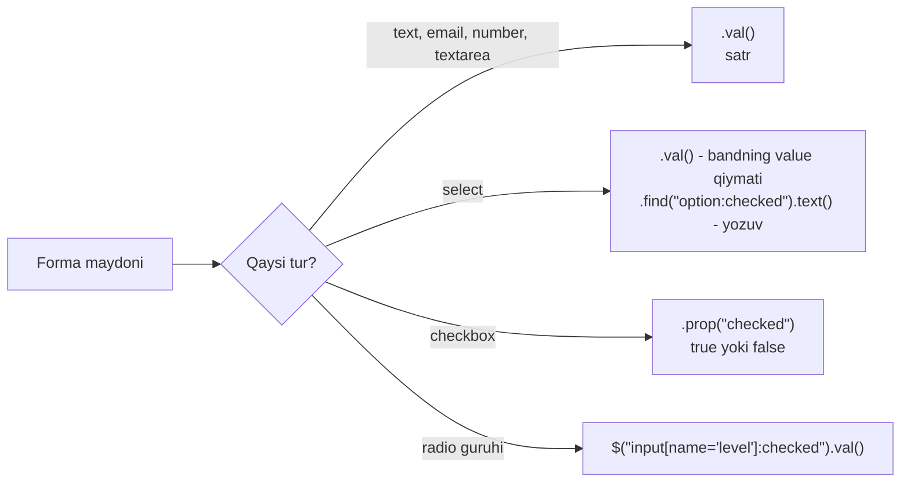
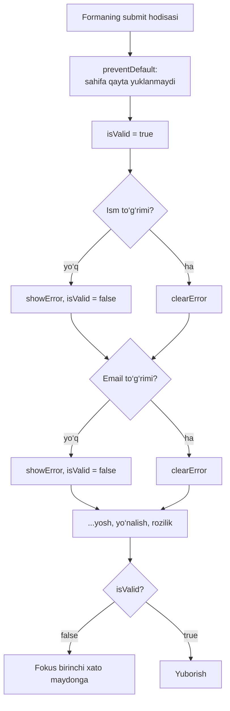
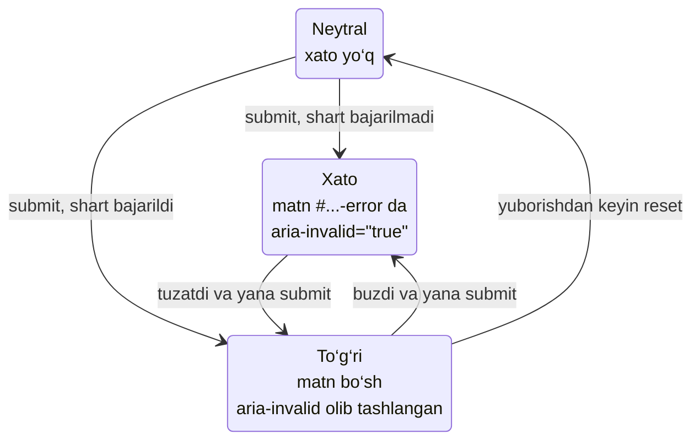
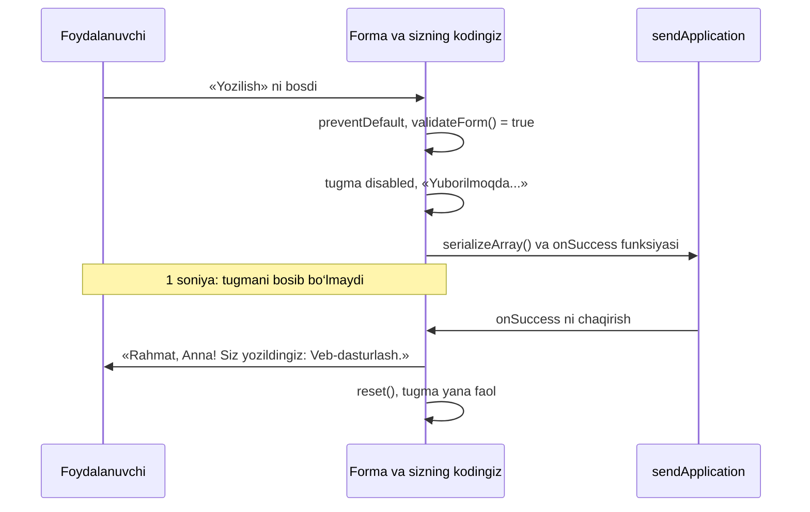

# Formalar

[Mundarija](../../README.md) · [← Orqaga](../../Lesson-7/uz/Effektlar%20va%20animatsiya.md) · [Keyingi →](../../Lesson-9/uz/AJAX%20-%20ma'lumotlarni%20yuklash.md) · [RU](../ru/%D0%A4%D0%BE%D1%80%D0%BC%D1%8B.md) · [EN](../en/Forms.md) · [UZ](Formalar.md)

> **7-dars bilan bog‘liqlik:** siz elementlarni silliq ko‘rsatish va yashirishni, 6-darsda esa hodisalarga obuna bo‘lish va brauzer harakatini bekor qilishni o‘rgandingiz. Bugun bularning hammasini saytning eng muhim elementi - **forma** ustida birlashtiramiz: barcha maydonlarni o‘qiymiz, ularni tekshiramiz, xatolarni maydonlar yonida ko‘rsatamiz va arizani ehtiyotkorlik bilan «yuboramiz».

---

## Bu sizga nima uchun kerak

Tasavvur qiling: universitetda dasturlash to‘garagi ochilmoqda va unga yozilish saytdagi forma orqali bo‘ladi. Abituriyent emailni yozishni unutdi - va bu haqda faqat sahifa qayta yuklangandan keyin, kiritgan hamma narsasi yo‘qolganda biladi. Yoki «Yozilish» tugmasini uch marta bosdi, chunki hech narsa bo‘lmayotgan edi - va ro‘yxatda uchta bir xil ariza paydo bo‘ldi. Yoki «Formada xato» yozuvini ko‘radi, lekin qaysi maydon noto‘g‘ri ekanini tushunmaydi.

Yaxshi forma nimani tuzatish kerakligini darhol va maydonning yonida aytadi, kiritilgan ma’lumotni yo‘qotmaydi, yuborish vaqtida tugmani bloklaydi va muvaffaqiyatdan keyin tozalanadi. jQuery ishlatiladigan deyarli har bir saytda shunday formalar bor: yozilish, qayta aloqa, buyurtma, ro‘yxatdan o‘tish. JavaScript kursida siz tekshiruvni sof JS’da qilgansiz - bugun xuddi shu narsa qisqaroq bo‘ladi, forma ma’lumotlari esa **bitta chaqiruv** bilan yig‘iladi.

---

## Nimani o‘rganasiz

- Forma yuborilishini sahifani qayta yuklamasdan `.on("submit", ...)` orqali ishlash.
- Matnli maydonlar, sonlar va `<select>` ro‘yxatlarining qiymatlarini o‘qish: `.val()`.
- Belgilash katakchalari va radiotugmalarning holatini bilish: `.prop("checked")`, `:checked`, `.is()`.
- Formaning barcha ma’lumotlarini bitta chaqiruv bilan yig‘ish: `.serialize()` va `.serializeArray()`.
- **Barcha** xatolarni birdaniga maydonlar yonida ko‘rsatish va ularni ekran o‘qish dasturlari uchun belgilash: `aria-invalid`.
- Yuborish vaqtida tugmani bloklash va muvaffaqiyatdan keyin formani tozalash.

---

## Takrorlash: 7-darsdan 3 savol

1. `.hide()` `.fadeOut(400)` dan nimasi bilan farq qiladi? Oxirida ularning umumiy tomoni nima?
2. Tugash funksiyasini nima uchun uzatish kerak: `$box.fadeOut(400, function () { ... })`?
3. `$.fx.off = true` nima qiladi va u kimga kerak?

Javoblar - dars oxirida.

---

## Reja

| Bo‘lim | Nima qilamiz |
| --- | --- |
| Forma va `submit` hodisasi | Yuborishni sahifani qayta yuklamasdan ushlab qolish |
| Maydon qiymatlari | Matn, son va ro‘yxatlarda `.val()` |
| Belgilash katakchalari va radiotugmalar | `.prop("checked")` va `:checked` |
| Mini-topshiriq 1 | Profil sozlamalari sahifasi |
| Formaning barcha ma’lumotlari birdaniga | `.serialize()` va `.serializeArray()` |
| Maydonlarni tekshirish | Qoidalar, barcha xatolar birdaniga |
| Maydon yonidagi xatolar | `aria-invalid`, `aria-describedby`, fokus |
| Yuborish | Tugmani bloklash, «server» javobi, tozalash |
| Mini-topshiriq 2 | Obuna formasi |
| Mustaqil ish | To‘garakka yozilish formasi |

---

## Forma va `submit` hodisasi

### Yuborishni qayerda ushlash kerak

**Oddiy so‘z bilan:** forma - bu ariza blankasi, `submit` hodisasi esa inson blankani darchaga topshiradigan payt. U buni qanday qilgani muhim emas: qo‘li bilan uzatdimi (tugma) yoki qo‘shnisidan so‘radimi (maydonda Enter tugmasi). Shuning uchun darcha oldida - tugmada emas, **formada** kutib turish kerak.

```html
<form id="signup-form" novalidate>
    <label for="name">Ism</label>
    <input id="name" name="name" type="text">
    <button type="submit">Yozilish</button>
</form>
```

```js
const $form = $("#signup-form");

$form.on("submit", function (event) {
    event.preventDefault();             // sahifani qayta yuklamaslik
    console.log("Forma yuborildi");
});
```

| Sof JavaScript (JS kursi, 9-dars) | jQuery |
| --- | --- |
| `form.addEventListener("submit", (event) => { ... })` | `$form.on("submit", function (event) { ... })` |
| `event.preventDefault()` | `event.preventDefault()` - xuddi shu metod |

### `preventDefault` nima uchun kerak

Usiz brauzer standart harakatni bajaradi: ma’lumotlarni `action` dagi manzilga (yoki o‘sha sahifaning o‘ziga) yuboradi va uni **qayta yuklaydi**. Barcha xabarlaringiz va kiritilgan ma’lumotlar yo‘qoladi. `preventDefault` bilan siz 6-darsda havolalar misolida uchrashgansiz - bu yerda ham xuddi shunday.

> **Muhim:** `event.preventDefault()` ni ishlovchining **birinchi qatorida** - tekshiruvlardan oldin chaqiring. Agar pastroqda kodda xato yuz bersa, hech bo‘lmaganda sahifa qayta yuklanmaydi va siz konsolda xabarni ko‘rasiz.

Eski kodda `$form.submit(function () { ... })` ni uchratasiz - bu qisqartma 6-darsdagi `.click(fn)` kabi eskirgan. Yuborishni koddan `$form.trigger("submit")` orqali chaqirish mumkin: sizning ishlovchilaringiz ishlaydi, agar ulardan birortasi `preventDefault` ni chaqirmasa, brauzer formani yuboradi.

### `novalidate` atributi

`required`, `type="email"`, `min` va `max` atributlari brauzerni formani o‘zi tekshirishga va o‘z ko‘rsatmalarini chiqarishga majbur qiladi - har bir brauzerda ular har xil. `<form>` dagi `novalidate` ularni o‘chiradi: tekshiruv va xato matnlarini **sizning** kodingiz bajaradi. `type` va `required` atributlarini qoldiring - ular maydonning ma’nosini tasvirlaydi.

---

## Maydon qiymatlari: `.val()`

`.val()` ni 3-darsdan bilasiz. Formalarda u asosiy vosita, shuning uchun u turli maydonlarda nimani qaytarishini ko‘rib chiqamiz.

```html
<input id="age" name="age" type="number">
<select id="direction" name="direction">
    <option value="">Yo‘nalishni tanlang</option>
    <option value="web">Veb-dasturlash</option>
    <option value="python">Boshlovchilar uchun Python</option>
</select>
```

| Maydon | `.val()` qaytaradi | Misol |
| --- | --- | --- |
| `<input type="text">` | Terilgan matn | `" Anna "` - kiritilganidek, bo‘shliqlar bilan |
| `<input type="number">` | Sonli **satr** yoki `""` | `20` emas, `"20"` |
| `<select>` | Tanlangan `<option>` ning `value` qiymati | «Veb-dasturlash» emas, `"web"` |

### Maydondagi son - doim satr

```js
const age = Number($("#age").val());   // "20" → 20
console.log(age + 1);                   // 21, Number’siz esa "201" bo‘lardi
```

`type="number"` maydonida brauzer harflarni kiritishga yo‘l qo‘ymaydi, lekin bo‘sh maydon `""` beradi, `Number("")` esa `0` ga teng. Shuning uchun bo‘shlikni ham, `Number.isNaN()` ni ham tekshiring - JavaScript kursidagidek.

### Ro‘yxat: qiymat va yozuv

`<select>` da ikki xil «javob» bor: dastur uchun xizmat `value` qiymati va inson uchun yozuv.

```js
const $direction = $("#direction");

$direction.val();                           // "web" - tekshiruvlar va server uchun
$direction.find("option:checked").text();   // "Veb-dasturlash" - xabar uchun
```

`option:checked` selektori - oddiy CSS: ro‘yxatlarda tanlangan band «belgilangan» hisoblanadi. Eski kodda `option:selected` ni ko‘rasiz - bu jQuery kengaytmasi, u ham ishlaydi, lekin CSS varianti tushunarliroq va tezroq.

---

## Belgilash katakchalari va radiotugmalar

### Belgilash katakchasi: `.prop("checked")`

**Oddiy so‘z bilan:** katakchada «qutidagi yozuv» - `value` - va «kalit» - `checked` bor. `.val()` bosishdan o‘zgarmaydigan yozuvni o‘qiydi. Bizga deyarli doim kalit kerak.

```html
<label>
    <input id="agree" name="agree" type="checkbox">
    To‘garak qoidalariga roziman
</label>
```

```js
const $agree = $("#agree");

$agree.prop("checked");      // true yoki false - hozir belgilanganmi
$agree.is(":checked");       // xuddi shu
$agree.val();                // "on" - DOIM, hatto belgilanmagan bo‘lsa ham!
```

| Yozuv | Nimani qaytaradi | Tekshiruv uchun yaraydimi? |
| --- | --- | --- |
| `$agree.prop("checked")` | `true` / `false` - joriy holat | Ha |
| `$agree.attr("checked")` | HTML’dagi atribut: `"checked"` yoki `undefined`, bosishdan o‘zgarmaydi | Yo‘q (3-dars) |
| `$agree.val()` | Katakchaning `value` qiymati, atributsiz - `"on"` | Yo‘q |

### Radiotugmalar: guruhdan tanlangani

Bir xil `name` ga ega `type="radio"` radiotugmalari - bitta guruh, ulardan faqat bittasini tanlash mumkin.

```html
<label><input type="radio" name="level" value="beginner" checked> Yangi boshlovchi</label>
<label><input type="radio" name="level" value="pro"> Dasturlashni bilaman</label>
```

```js
const level = $("input[name='level']:checked").val();   // "beginner" yoki "pro"
```

Selektor shunday o‘qiladi: «`name="level"` bo‘lgan va hozir belgilangan maydon». Birortasi belgilanmagan bo‘lsa, jQuery obyekti bo‘sh bo‘ladi va `.val()` `undefined` qaytaradi.

| Yozuv | Natija |
| --- | --- |
| `$("input[name='level']:checked").val()` | Tanlangan radiotugmaning `value` qiymati |
| `$("input[name='level']").val()` | Ikkinchisi tanlangan bo‘lsa ham, guruhdagi **birinchisining** `value` qiymati - tuzoq |



**Sxemani qanday o‘qish kerak.** Avval maydon turiga qarang, keyin o‘qish usulini tanlang. Matn va ro‘yxatlar uchun - `.val()`, «yoqilgan/o‘chirilgan» uchun - `.prop("checked")`, radiotugmalar guruhi uchun - avval belgilanganini toping, keyin undan `.val()` ni so‘rang.

---

## Mini-topshiriq 1

Profil sozlamalari sahifasi:

```html
<input id="nickname" type="text">
<select id="lang">
    <option value="ru">Ruscha</option>
    <option value="uz">O'zbekcha</option>
</select>
<input id="notify" type="checkbox">
<input type="radio" name="level" value="Yangi boshlovchi" checked>
<input type="radio" name="level" value="Tajribali">
<button id="show-btn" type="button">Ko‘rsatish</button>
<p id="summary"></p>
```

`#show-btn` bosilganda `#summary` ga `Nik: anna, til: Ruscha, bildirishnomalar: ha, daraja: Yangi boshlovchi` ko‘rinishidagi satrni yozing. Nik - chetlaridagi bo‘shliqlarsiz; til - tanlangan bandning **yozuvi**; bildirishnomalar - katakcha holatiga qarab `ha` yoki `yo‘q`.

---

## Formaning barcha ma’lumotlari birdaniga

Har bir maydonni alohida o‘qish - uzoq ish. jQuery butun formani bitta chaqiruv bilan yig‘a oladi. Bu maydonlarning **`name`** atributi bo‘yicha ishlaydi - HTML kursida ma’lumotlarni serverga yuborgan o‘sha atribut.

**Oddiy so‘z bilan:** `.serialize()` va `.serializeArray()` - to‘ldirilgan blankani olib, uni jurnalga ko‘chirib yozadigan xodimga o‘xshaydi. U faqat nomi (`name`) bor ustunlarni ko‘chiradi, o‘chirilganlarini (`disabled`) va belgilanmagan katakchalarni tashlab ketadi.

```html
<form id="signup-form">
    <input name="name" value="Anna Li">
    <input name="age" value="20">
    <input name="agree" type="checkbox">
</form>
```

### `.serializeArray()` - juftliklar massivi

```js
const data = $("#signup-form").serializeArray();
console.log(data);
// [ { name: "name", value: "Anna Li" }, { name: "age", value: "20" } ]
```

Bu JS kursining 6-darsidagi `{ name, value }` obyektlari massivi. Uni aylanib chiqish yoki kerakli maydonni topish qulay:

```js
const ageField = data.find((field) => field.name === "age");
console.log(ageField.value); // "20" - satr!
```

### `.serialize()` - server uchun satr

```js
$("#signup-form").serialize();
// "name=Anna%20Li&age=20"
```

Bu brauzer GET-formani yuborishda manzilga qo‘shadigan o‘sha satr: `&` orqali ajratilgan `nom=qiymat` juftliklari, kirill harflari va bo‘shliqlar kodlangan (`%D0%90...`, `%20`). Bunday satr serverga yuboriladi - 9-darsda `$.post` orqali.

| Metod | Nimani qaytaradi | Qachon kerak |
| --- | --- | --- |
| `.serializeArray()` | `[{ name, value }, ...]` massivi | Kodda ma’lumotlarni aylanib chiqish, topish, ko‘rsatish |
| `.serialize()` | `name=...&age=...` satri | Serverga yuborish (9-dars) |

### Natijaga nima tushadi

| Maydon | Tushadimi? |
| --- | --- |
| `name` bor maydon | Ha |
| `name` siz maydon | Yo‘q |
| `disabled` bor maydon | Yo‘q |
| Belgilanmagan katakcha | Yo‘q |
| `value` siz belgilangan katakcha | Ha, qiymati `"on"` |
| Radiotugmalar guruhi | Faqat tanlangani |

> **Muhim:** `.serializeArray()` qiymatlarni **qanday bo‘lsa, shunday** qaytaradi: bo‘shliqli satrlar, satr ko‘rinishidagi sonlar. Ma’lumotlarni tekshirish va tozalash (`trim`, `Number`) baribir o‘zingizning vazifangiz.

---

## Maydonlarni tekshirish

### Qoidalar

To‘garakka yozilish formasi uchun beshta qoidani tekshiramiz:

| Maydon | Xato sharti | Xabar |
| --- | --- | --- |
| Ism | `trim()` dan keyin `name === ""` | «Ismingizni kiriting» |
| Ism | `name.length < 2` | «Ism - kamida 2 ta belgi» |
| Email | `!email.includes("@")` | «@ belgisi bor email kiriting» |
| Yosh | bo‘sh, `Number.isNaN(age)`, `age < 14` yoki `age > 60` | «Yosh - 14 dan 60 gacha son» |
| Yo‘nalish | `$direction.val() === ""` | «Yo‘nalishni tanlang» |
| Rozilik | `!$agree.prop("checked")` | «Qoidalarga roziligingizni tasdiqlang» |

### Ikki yordamchi: xatoni ko‘rsatish va olib tashlash

Har bir maydonning yonida xato uchun o‘z xatboshisi bor, ularning bog‘liqligi esa maydonning `aria-describedby` atributida yozilgan:

```html
<input id="email" name="email" type="email" aria-describedby="email-error">
<p id="email-error" class="error"></p>
```

```js
function showError($field, text) {
    $(`#${$field.attr("aria-describedby")}`).text(text);
    $field.attr("aria-invalid", "true");
}

function clearError($field) {
    $(`#${$field.attr("aria-describedby")}`).text("");
    $field.removeAttr("aria-invalid");
}
```

`` $(`#${$field.attr("aria-describedby")}`) `` yozuvi shunday o‘qiladi: maydondan `aria-describedby` atributini ol (`"email-error"`), oldiga `#` qo‘sh - `#email-error` selektori hosil bo‘ladi. Bitta funksiya istalgan maydon uchun ishlaydi.

### Barcha xatolar birdaniga

JavaScript kursida biz birinchi xatodan keyin `return` orqali chiqib ketardik. Bu oddiy, lekin noqulay: inson ismni tuzatadi, tugmani bosadi - va faqat shundan keyin email haqida biladi. **Barcha** xatolarni birdaniga ko‘rsatamiz. Buning uchun bayroq ochamiz.

**Oddiy so‘z bilan:** o‘qituvchi nazorat ishini tekshiryapti. U birinchi xatoda to‘xtamaydi, balki hammasining tagiga chizadi va faqat oxirida yakuniy bahoni qo‘yadi: «o‘tdi» yoki «yo‘q». `isValid` bayrog‘i - xuddi shu yakuniy baho.

```js
function validateForm() {
    let isValid = true;

    const name = $name.val().trim();
    if (name === "") {
        showError($name, "Ismingizni kiriting");
        isValid = false;
    } else if (name.length < 2) {
        showError($name, "Ism - kamida 2 ta belgi");
        isValid = false;
    } else {
        clearError($name);
    }

    // ...xuddi shunday email, yosh, yo‘nalish va rozilik

    return isValid;
}
```



**Sxemani qanday o‘qish kerak.** Har bir maydon mustaqil tekshiriladi: to‘g‘ri bo‘lsa - xato olib tashlanadi, noto‘g‘ri bo‘lsa - ko‘rsatiladi, bayroq esa `false` ga tushadi. Hech bir tarmoq funksiyadan muddatidan oldin chiqmaydi. «Yuborish yoki yo‘q» qarori eng oxirida bir marta qabul qilinadi.

Kuzatuv: foydalanuvchi ismni bo‘sh qoldirdi, email `anna.mail.uz`, qolganlari to‘g‘ri.

| Qadam | Nima bo‘ladi | Qiymat / sahifa holati |
| --- | --- | --- |
| 1 | `let isValid = true` | `isValid = true` |
| 2 | `name = "".trim()` → `""` | Ismda: «Ismingizni kiriting», `aria-invalid="true"`; `isValid = false` |
| 3 | `"anna.mail.uz".includes("@")` → `false` | Emailda: «@ belgisi bor email kiriting»; `isValid = false` |
| 4 | Yosh `"20"` → 20, oraliqda | Yosh xatosi tozalandi |
| 5 | Yo‘nalish va rozilik to‘g‘ri | Ularning xatolari tozalandi |
| 6 | `return isValid` | `false` - yuborish yo‘q, ikkita xato ko‘rinadi |

---

## Maydon yonidagi xatolar va foydalanish imkoniyati

### `aria-invalid` va `aria-describedby`

Qizil chegara ko‘z bilan ko‘rinadi, lekin ekran o‘qish dasturidan foydalanadigan inson uni ko‘rmaydi. HTML kursidagi ikkita atribut buni hal qiladi:

| Atribut | Kimda | Ekran o‘qish dasturiga nima deydi |
| --- | --- | --- |
| `aria-invalid="true"` | Maydonda | «Maydon noto‘g‘ri to‘ldirilgan» |
| `aria-describedby="email-error"` | Maydonda | «Maydon tavsifi - `#email-error` elementida»: dastur xato matnini yozuv bilan birga o‘qiydi |

Alohida klass ochmaslik uchun o‘sha atributni CSS’da ishlatish qulay:

```css
input[aria-invalid="true"],
select[aria-invalid="true"] {
    border-color: #b91c1c;
}
```

> **Muhim:** maydon tuzatilganda atribut aynan `.removeAttr("aria-invalid")` orqali **olib tashlanadi**. Agar `aria-invalid="true"` qoldirilsa, chegara qizil bo‘lib qoladi, ekran o‘qish dasturi esa to‘g‘ri maydon haqida «noto‘g‘ri» deydi.

### Maydon holati



**Sxemani qanday o‘qish kerak.** Maydon uchta holatdan birida bo‘ladi. O‘tishlar forma yuborilganda sodir bo‘ladi: `showError` «Xato» holatiga, `clearError` - «To‘g‘ri» holatiga o‘tkazadi. Muvaffaqiyatli yuborish va tozalashdan keyin forma boshlang‘ich holatga qaytadi.

### Birinchi xato maydonga fokus

Kursorni darhol tuzatish kerak bo‘lgan joyga qo‘yish qulay: `$form.find("[aria-invalid='true']").first().trigger("focus")`. 2- va 6-darslardagi zanjir: forma ichidan xatoli maydonlarni topish, birinchisini olish, unda `focus` hodisasini chaqirish.

---

## Yuborish: tugmani bloklash va tozalash

### O‘quv «serveri»

Serverga haqiqiy yuborishni 9-darsda ko‘rib chiqamiz. Hozircha server - `sendApplication(data, onSuccess)` funksiyasi deb tasavvur qilamiz: u ma’lumotlarni qabul qiladi va **bir soniyadan keyin** `onSuccess` funksiyasini chaqiradi - go‘yo server «qabul qilindi» deb javob bergandek. Ichida bu JavaScript kursidagi oddiy `setTimeout`:

```js
function sendApplication(data, onSuccess) {
    console.log("Yuboryapmiz:", data);
    setTimeout(onSuccess, 1000);
}
```

**Oddiy so‘z bilan:** siz arizani darchaga topshirdingiz va sizga «kutib turing, chaqiramiz» deyishdi. Darcha oldida hech narsa qilmay kutish shart emas - hammasi tayyor bo‘lganda sizni chaqirishadi (`onSuccess`). Bunday «meni keyin chaqiring» funksiyasi **qayta chaqiruv funksiyasi** (callback) deyiladi: siz ularni `.on()` va `.fadeOut()` ga allaqachon uzatgansiz.

### Yuborish vaqtidagi tugma

Bir soniya - bu uzoq. Agar hech narsa o‘zgarmasa, inson tugmani yana bosadi. Shuning uchun yuborish vaqtida tugmani bloklaymiz va matnini o‘zgartiramiz: `$submitBtn.prop("disabled", true).text("Yuborilmoqda...")`. `disabled` - jonli xususiyat, shuning uchun `checked` kabi `.prop()` ishlatiladi (3-dars). Bloklangan tugmani bosib bo‘lmaydi, brauzer esa formani Enter orqali yubormaydi.

### Formani tozalash

jQuery’da `.reset()` metodi yo‘q. U formaning DOM elementida bor - uni `[0]` orqali olamiz (1-dars): `$form[0].reset()` barcha maydonlarni HTML’dagi boshlang‘ich qiymatlariga qaytaradi. Boshqa variant - `$form.trigger("reset")`.

### Butun ishlovchi

```js
$form.on("submit", function (event) {
    event.preventDefault();
    $message.text("");

    if (!validateForm()) {
        $form.find("[aria-invalid='true']").first().trigger("focus");
        return;
    }

    const name = $name.val().trim();
    const directionText = $direction.find("option:checked").text();
    const data = $form.serializeArray();

    $submitBtn.prop("disabled", true).text("Yuborilmoqda...");

    sendApplication(data, function () {
        $message.text(`Rahmat, ${name}! Siz yozildingiz: ${directionText}.`);
        $form[0].reset();
        $submitBtn.prop("disabled", false).text("Yozilish");
    });
});
```

E’tibor bering: ism va yo‘nalish yuborishdan **oldin** konstantalarga saqlab qo‘yiladi. Bir soniyadan keyin `onSuccess` ishlaganda biz `reset()` ni chaqiramiz va maydonlar bo‘shab qoladi - xabarda esa kiritilgan ma’lumotlar bo‘lishi kerak.



**Sxemani qanday o‘qish kerak.** `submit` ishlovchisi javobni kutmaydi: u tugmani bloklaydi, ma’lumotlar va funksiyani «server»ga uzatadi va tugaydi. Bir soniyadan keyin «server» o‘zi `onSuccess` ni chaqiradi va faqat shundagina xabar paydo bo‘ladi, forma tozalanadi, tugma esa blokdan chiqariladi.

Muvaffaqiyatli yuborish kuzatuvi:

| Qadam | Nima bo‘ladi | Qiymat / sahifa holati |
| --- | --- | --- |
| 1 | `preventDefault()`, `$message.text("")` | Sahifa qayta yuklanmaydi, xabar bo‘sh |
| 2 | `validateForm()` | `true`, barcha xatolar tozalangan |
| 3 | `name`, `directionText`, `data` | `"Anna"`, `"Veb-dasturlash"`, 5 juftlikdan iborat massiv |
| 4 | `.prop("disabled", true).text("Yuborilmoqda...")` | Tugma kulrang, yozuv «Yuborilmoqda...» |
| 5 | `sendApplication(data, fn)` | Ishlovchi tugadi, kutish davom etmoqda |
| 6 | 1 s dan keyin - `fn()` | `#form-message` da: «Rahmat, Anna! Siz yozildingiz: Veb-dasturlash.» |
| 7 | `$form[0].reset()` | Maydonlar bo‘sh, katakcha belgisi olingan, ro‘yxatda «Yo‘nalishni tanlang» |
| 8 | `.prop("disabled", false).text("Yozilish")` | Tugmani yana bosish mumkin |

---

### Buzib ko‘ring

1. `event.preventDefault()` ni olib tashlang va formani yuboring. Xabarlar va kiritilgan ma’lumotlar bilan nima bo‘ldi? Manzil satrida nima paydo bo‘ldi?
2. `$agree.prop("checked")` ni `$agree.val()` ga almashtiring va formani belgilanmagan katakcha bilan yuboring. Nega tekshiruv o‘tkazib yubordi?
3. Email maydonidan `name` atributini olib tashlang va `$form.serializeArray()` ni konsolga chiqaring. Email qayerga yo‘qoldi?
4. `const name = $name.val().trim();` ni `onSuccess` ichiga, `reset()` dan keyinga ko‘chiring. Xabarda nima bo‘ladi?
5. `.prop("disabled", true)` qatorini olib tashlang va tugmani tez-tez uch marta bosing. Konsolda «Yuboryapmiz:» necha marta paydo bo‘ladi?

### Yangi o‘rganuvchilarning tipik xatolari

| Xato | Nima bo‘ladi | Qanday tuzatish |
| --- | --- | --- |
| Ishlovchi tugmaning `click` hodisasida | Maydonda Enter formani tekshiruvni chetlab yuboradi | `$form.on("submit", ...)` |
| `preventDefault()` yo‘q | Sahifa qayta yuklanadi, hammasi yo‘qoladi | Ishlovchining birinchi qatorida |
| Katakcha `.val()` yoki `.attr("checked")` orqali | «Rozilik» doim bor yoki o‘zgarmaydi | `.prop("checked")` yoki `.is(":checked")` |
| Yosh songa aylantirilmagan | `$age.val() + 1` `"201"` beradi, `"9" > "60"` esa rost: satrlar harfma-harf solishtiriladi | `const age = Number($age.val())` |
| `trim()` yo‘q | Bo‘shliqlardan iborat ism tekshiruvdan o‘tadi | `$name.val().trim()` |
| Birinchi xatodan keyin `return` | Uchta xatodan faqat bittasi ko‘rinadi | `let isValid = true` bayrog‘i |
| Xato ko‘rsatildi, lekin olib tashlanmadi | Tuzatilgan maydon qizil bo‘lib qoldi | `clearError`: bo‘sh matn va `.removeAttr("aria-invalid")` |
| `$form.reset()` | `TypeError: $form.reset is not a function` | `$form[0].reset()` |

---

## Mini-topshiriq 2

To‘garak yangiliklariga obuna formasi:

```html
<form id="subscribe-form" novalidate>
    <input id="sub-email" name="email" type="email" aria-describedby="sub-email-error">
    <p id="sub-email-error" class="error"></p>
    <select id="topic" name="topic" aria-describedby="topic-error">
        <option value="">Xabarnoma mavzusi</option>
        <option value="events">Tadbirlar</option>
        <option value="lessons">Yangi darslar</option>
    </select>
    <p id="topic-error" class="error"></p>
    <button type="submit">Obuna bo‘lish</button>
</form>
<p id="subscribe-message" role="status"></p>
```

1. Darsdagi `showError` va `clearError` funksiyalaridan foydalaning.
2. Sahifani qayta yuklamasdan yuborishda ikkala maydonni tekshiring: email `@` ni o‘z ichiga oladi, mavzu tanlangan. Ikkala xatoni birdaniga ko‘rsating.
3. Xatolar bo‘lmasa - konsolga `$form.serialize()` ni chiqaring, `#subscribe-message` ga `Obuna rasmiylashtirildi: anna@mail.uz` matnini yozing va formani tozalang.

---

## Dars yakuni: shpargalka

| Vazifa | Yozuv |
| --- | --- |
| Yuborishni ushlab qolish | `$form.on("submit", function (event) { event.preventDefault(); ... })` |
| Maydon yoki ro‘yxat qiymati | `$field.val()` - doim satr |
| Tanlangan band yozuvi | `$select.find("option:checked").text()` |
| Katakcha belgilanganmi | `$agree.prop("checked")` yoki `$agree.is(":checked")` |
| Tanlangan radiotugma | `$("input[name='level']:checked").val()` |
| Ma’lumotlar massiv ko‘rinishida | `$form.serializeArray()` → `[{ name, value }]` |
| Ma’lumotlar satr ko‘rinishida | `$form.serialize()` → `"name=...&age=..."` |
| Xatoni ko‘rsatish | Xato elementiga `.text("...")` + `.attr("aria-invalid", "true")` |
| Xatoni olib tashlash | `.text("")` + `.removeAttr("aria-invalid")` |
| Tugmani bloklash | `$btn.prop("disabled", true)` |
| Formani tozalash | `$form[0].reset()` |

---

## Mustaqil ish

### 1-qism. IDE topshirig‘i (platforma hisoblaydi)

Sahifada `#name`, `#email`, `#age` maydonlari, `#direction` ro‘yxati va `#agree` katakchasi bo‘lgan `#signup-form` to‘garakka yozilish formasi bor. Har bir maydonning o‘z xato elementi bor (`#name-error` va h.k.), uning id si maydonning `aria-describedby` atributida yozilgan. Tugma - `#submit-btn`, muvaffaqiyat xabari - `#form-message`. O‘quv «serveri» `sendApplication(data, onSuccess)` allaqachon bor: u ma’lumotlarni qabul qiladi va bir soniyadan keyin `onSuccess` ni chaqiradi.

1. `showError($field, text)` ni yozing: matn maydonning xato elementiga va maydonga `aria-invalid="true"`; `clearError($field)`: bo‘sh matn va `aria-invalid` siz.
2. `validateForm()` ni yozing: u **barcha** maydonlarni birdaniga tekshiradi va `true` yoki `false` qaytaradi. `trim()` dan keyin ism bo‘sh emas («Ismingizni kiriting») va 2 ta belgidan qisqa emas («Ism - kamida 2 ta belgi»); email `@` ni o‘z ichiga oladi («@ belgisi bor email kiriting»); yosh - 14 dan 60 gacha (shu sonlar ham kiradi) son («Yosh - 14 dan 60 gacha son»); `#direction` da yo‘nalish tanlangan («Yo‘nalishni tanlang»); `#agree` katakchasi belgilangan («Qoidalarga roziligingizni tasdiqlang»). To‘g‘ri maydonlarning xatosi tozalanadi.
3. `$form.on("submit", ...)` ishlovchisi: brauzer yuborishini bekor qiladi, `#form-message` ni tozalaydi va formani tekshiradi.
4. Xatolar bo‘lmasa: `#submit-btn` ni bloklaydi va unga `Yuborilmoqda...` deb yozadi, `sendApplication($form.serializeArray(), funksiya)` ni chaqiradi. Funksiyada: `#form-message` ga `Rahmat, Anna! Siz yozildingiz: Veb-dasturlash.` matni (`trim` dan keyingi ism va tanlangan yo‘nalish matni), formani tozalash, tugma yana `Yozilish` matni bilan faol.

`document.querySelector`, `innerHTML`, `.html()` va `.submit(fn)` dan foydalanmang.

Platforma nimani tekshiradi: bo‘sh formada beshta xatoning hammasi matni va maydonlardagi `aria-invalid`; uch usulda (`.trigger("submit")`, `requestSubmit()` va `submit` hodisasi) yuborishda sahifa qayta yuklanmasligi; bo‘shliqlardan va bitta harfdan iborat ism; `@` siz email; yoshning 13, 14, 60, 61 chegaralari va bo‘sh maydon; ro‘yxat va katakcha; tuzatilgan maydonlar xatosini yo‘qotishi; tugmaning bloklanishi va `sendApplication` dagi `.serializeArray()` ma’lumotlari; javobdan keyin xabar, formaning tozalanishi va tugmaning blokdan chiqishi; kod xatolarsiz bajarilishi.

### 2-qism. Kompyuterdagi loyiha

1. HTML, CSS va JS kurslaridagi saytingizga qayta aloqa formasini qo‘shing: ism, email, mavzu (`<select>`), xabar (`<textarea>`), rozilik katakchasi. Formada `novalidate`, har bir maydonda `name`, `aria-describedby` va xato elementi bo‘lsin.
2. JavaScript kursidagi tekshiruvni `showError` / `clearError` va `isValid` bayrog‘i bilan jQuery’da qayta yozing; xatolarni CSS’da `[aria-invalid="true"]` orqali bezang.
3. `setTimeout` asosida o‘z `sendApplication` funksiyangizni yarating: tugmani bloklash, muvaffaqiyat xabari, formani tozalash. 9-darsda uni haqiqiy `$.post` bilan almashtirasiz.
4. Maydonni tuzatish boshlanishi bilanoq xatoni olib tashlang: 6-darsdagi delegatsiya - `$form.on("input change", "input, select, textarea", function () { clearError($(this)); })`.

### Tayyorlik mezonlari

- [ ] IDE topshirig‘i qabul qilindi.
- [ ] Forma ham tugma bilan, ham Enter tugmasi bilan yuboriladi, sahifa qayta yuklanmaydi.
- [ ] Barcha xatolar birdaniga, har biri o‘z maydoni yonida ko‘rinadi va tuzatilgandan keyin yo‘qoladi.
- [ ] Katakcha holati `.prop("checked")` orqali o‘qiladi, sonlar `Number()` orqali aylantiriladi.
- [ ] Siz `.serialize()` va `.serializeArray()` orasidagi farqni tushuntira olasiz.

---

## O‘zini tekshirish uchun savollar

1. Nega yuborish ishlovchisi tugmaga (`click`) emas, formaga (`submit`) osiladi?
2. `submit` ishlovchisida `event.preventDefault()` chaqirilmasa nima bo‘ladi?
3. `type="number"` maydonida `.val()` qanday turdagi qiymat qaytaradi va uni son bilan qanday solishtirish kerak?
4. `<select>` ning tanlangan bandi `value` qiymatini qanday olish mumkin va uning yozuvini-chi?
5. Nega katakcha belgilanganini bilish uchun `.val()` yaramaydi?
6. `name="level"` guruhida qaysi radiotugma tanlanganini qanday bilish mumkin?
7. `.serialize()` `.serializeArray()` dan nimasi bilan farq qiladi? Natijaga qaysi maydonlar tushmaydi?
8. Birinchi xatodan keyin `return` orqali chiqish mumkin bo‘lsa, `isValid` bayrog‘i nima uchun kerak?
9. Maydonga `aria-invalid` va `aria-describedby` atributlari nima uchun kerak?
10. Yuborish vaqtida tugmani nima uchun bloklash kerak va nega xabar uchun ma’lumotlarni `reset()` dan oldin saqlab qo‘yish kerak?

Savollardan keyin platformada **dars testini** topshiring: 12 ta savol, o‘tish chegarasi 70%.

---

## Keyin nima

Formamiz ma’lumotlarni yig‘adi va tekshiradi, lekin «server» hozircha haqiqiy emas - `setTimeout` dagi funksiya. 9-darsda sahifa **haqiqiy server bilan gaplasha** boshlaydi: kurslar ro‘yxatini `$.getJSON` orqali yuklaymiz, `.serialize()` satrini `$.post` orqali yuboramiz va `.done`, `.fail` va `.always` yordamida «yuklanmoqda», «xato» va «bo‘sh» holatlarini ko‘rsatishni o‘rganamiz. Bu darsdagi tugmani bloklash u yerda darhol asqotadi.

---

## Javoblar

**Takrorlash**

1. `.hide()` elementni bir zumda yashiradi, `.fadeOut(400)` esa shaffoflikni asta-sekin kamaytirib, 400 ms davomida silliq yashiradi. Oxirida ikkalasida ham element `display: none` oladi.
2. Animatsiya bir zumda tugamaydi: `.fadeOut()` dan keyingi kod element hali ko‘rinib turganida bajariladi. Tugash funksiyasi animatsiya tugaganda chaqiriladi - masalan, elementni o‘chirish uchun.
3. jQuery’ning barcha animatsiyalarini o‘chiradi: effektlar darhol oxirgi holatga keladi. Bu kamaytirilgan harakat rejimi (`prefers-reduced-motion`) yoqilgan odamlarga va avtomatik testlarga kerak.

**Mini-topshiriq 1**

```js
$("#show-btn").on("click", function () {
    const nickname = $("#nickname").val().trim();
    const langText = $("#lang").find("option:checked").text();
    const notify = $("#notify").prop("checked") ? "ha" : "yo‘q";
    const level = $("input[name='level']:checked").val();

    $("#summary").text(`Nik: ${nickname}, til: ${langText}, bildirishnomalar: ${notify}, daraja: ${level}`);
});
```

**Mini-topshiriq 2**

```js
const $subscribeForm = $("#subscribe-form");
const $subEmail = $("#sub-email");
const $topic = $("#topic");

// showError va clearError - darsdagi bilan bir xil

$subscribeForm.on("submit", function (event) {
    event.preventDefault();
    let isValid = true;

    const email = $subEmail.val().trim();
    if (!email.includes("@")) {
        showError($subEmail, "@ belgisi bor email kiriting");
        isValid = false;
    } else {
        clearError($subEmail);
    }

    if ($topic.val() === "") {
        showError($topic, "Xabarnoma mavzusini tanlang");
        isValid = false;
    } else {
        clearError($topic);
    }

    if (!isValid) {
        return;
    }

    console.log($subscribeForm.serialize());
    $("#subscribe-message").text(`Obuna rasmiylashtirildi: ${email}`);
    $subscribeForm[0].reset();
});
```

**O‘zini tekshirish uchun savollar**

1. Formani ham tugma bilan, ham maydonda Enter tugmasi bilan yuborishadi; `submit` ikkala usulni ham ushlaydi, tugmadagi `click` esa - faqat birinchisini.
2. Brauzer formani o‘zi yuboradi va sahifani qayta yuklaydi: xabarlar va kiritilgan ma’lumotlar yo‘qoladi.
3. Raqamlar kiritilgan bo‘lsa ham, satr. Avval `Number($age.val())`, keyin solishtirish; bo‘sh maydon va `NaN` alohida tekshiriladi.
4. `$select.val()` - tanlangan bandning `value` qiymati; `$select.find("option:checked").text()` - uning yozuvi.
5. `.val()` katakchaning `value` atributini qaytaradi (usiz - `"on"`), u bosishdan o‘zgarmaydi. Holat - `.prop("checked")` yoki `.is(":checked")`.
6. `$("input[name='level']:checked").val()`; hech narsa tanlanmagan bo‘lsa - `undefined`.
7. `.serialize()` - server uchun `name=...&age=...` satri, `.serializeArray()` - kod uchun `{ name, value }` massivi. `name` siz, `disabled` bor maydonlar, belgilanmagan katakchalar va radiotugmalar, tugmalar tushmaydi.
8. Barcha maydonlarni tekshirish va barcha xatolarni birdaniga ko‘rsatish uchun; yuborish haqidagi qaror oxirida bir marta qabul qilinadi.
9. `aria-invalid="true"` ekran o‘qish dasturiga maydon noto‘g‘ri to‘ldirilganini aytadi, `aria-describedby` maydonni xato matni bilan bog‘laydi va dastur uni yozuv bilan birga o‘qiydi.
10. Foydalanuvchi arizani qayta yubormasligi va yuborish ketayotganini ko‘rishi uchun. «Server» javobi keyinroq keladi, `reset()` dan keyin maydonlar bo‘sh - shuning uchun ism va yo‘nalish oldindan konstantalarga saqlanadi.

---

[Mundarija](../../README.md) · [← Orqaga](../../Lesson-7/uz/Effektlar%20va%20animatsiya.md) · [Keyingi →](../../Lesson-9/uz/AJAX%20-%20ma'lumotlarni%20yuklash.md) · [RU](../ru/%D0%A4%D0%BE%D1%80%D0%BC%D1%8B.md) · [EN](../en/Forms.md) · [UZ](Formalar.md)
