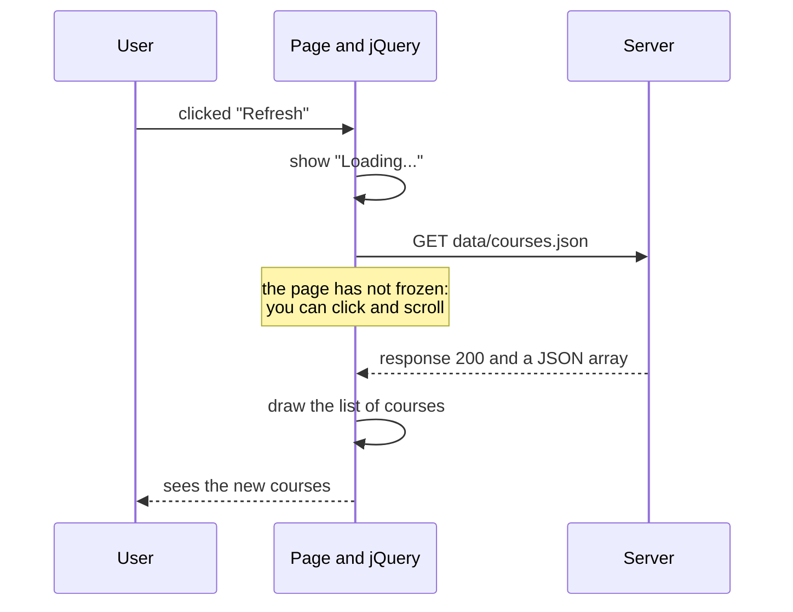
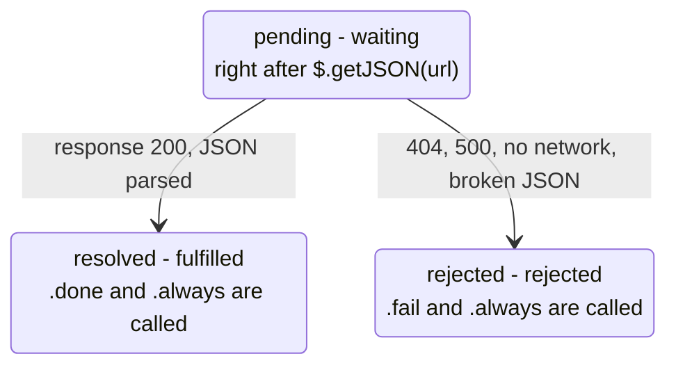
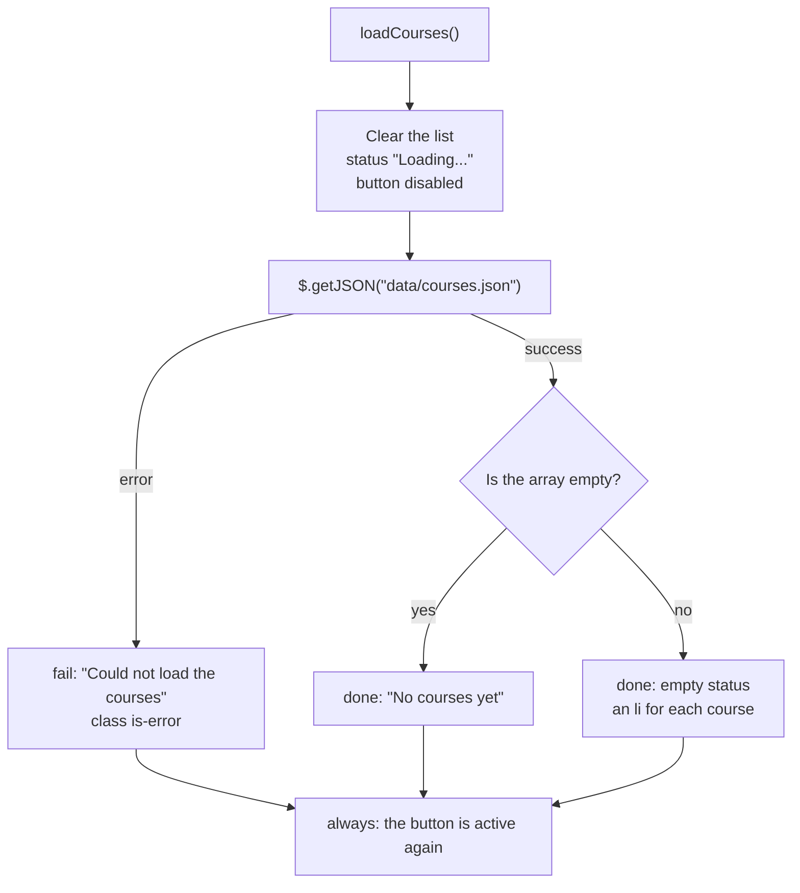

# AJAX - loading data

[Contents](../../README.md) · [← Back](../../Lesson-8/en/Forms.md) · [Next →](../../Lesson-10/en/Plugins%20and%20final%20project.md) · [RU](../ru/AJAX%20-%20%D0%B7%D0%B0%D0%B3%D1%80%D1%83%D0%B7%D0%BA%D0%B0%20%D0%B4%D0%B0%D0%BD%D0%BD%D1%8B%D1%85.md) · [EN](AJAX%20-%20loading%20data.md) · [UZ](../uz/AJAX%20-%20ma'lumotlarni%20yuklash.md)

> **Link to lesson 8:** you learned to collect form data with `.val()` and `.serialize()`, validate fields and disable the submit button. But so far the data went nowhere and came from nowhere. Today the page starts **talking to the server**: it loads a list of courses and sends an application - without reloading.

---

## Why you need this

Open any online store and click "Show more" - new products appear, but the page does not reload. Like a post on social media - the counter changes right away. Type a city into a weather field - the forecast loads by itself. In all these cases a script asks the server for data **in the background** and draws it on the page. This technique is called **AJAX**.

On sites with jQuery (and that is a huge number of WordPress sites) requests are almost always written with `$.ajax`, `$.getJSON` and `.done()`. In the JavaScript course you already did this with `fetch` and `await`. Today you will see how the same thing is written in jQuery and learn to read such code in other people's projects.

---

## What you will learn

- Explain what AJAX, a request and a response are, and what data in JSON format looks like.
- Load JSON with `$.getJSON` and understand what a request returns: a **jqXHR** object.
- Subscribe to the result: `.done()`, `.fail()`, `.always()`.
- Show four interface states: loading, data, "empty" and error.
- Wait for a jQuery request with `await` inside an `async` function.
- Send data: `$.get`, `$.post` and the universal `$.ajax` with settings.
- Run the page with Live Server, turn off the cache and read `jqXHR.responseURL` (new in 4.1).
- Save loaded data in `localStorage` and show it without a network.

---

## Review: 3 questions from lesson 8

1. What will `$("#signup-form").serialize()` return for a form with the fields `name = Anna` and `age = 20`?
2. How is `.prop("checked")` different from `.attr("checked")`?
3. Why do we call `event.preventDefault()` in a `submit` handler?

Answers are at the end of the lesson.

---

## Lesson plan

| Section | What we do |
| --- | --- |
| What AJAX is | A request and a response without reloading the page |
| JSON | The data format and the file `data/courses.json` |
| `$.getJSON` and jqXHR | The first request and its "receipt" |
| `.done`, `.fail`, `.always` | Subscribing to the result |
| Mini-task 1 | A teacher counter from JSON |
| Three states | Loading, data, empty, error |
| `await` with jQuery | The same request in the style of the JavaScript course |
| `$.get`, `$.post`, `$.ajax` | Sending data and request settings |
| Where a request works | `file://`, Live Server, cache, `responseURL` |
| `localStorage` | A saved copy of the data |
| Mini-task 2 | A catalog that works without a network |
| Independent work | The function `loadCourses()` |

---

## What AJAX is

**In simple words:** the page in the browser is a guest in a restaurant, and the server is the kitchen. In the past, to get a new dish, the guest had to leave the restaurant and come in again (reload the page). AJAX is the **waiter**: you keep sitting and talking, and the waiter takes the order to the kitchen and brings the dish right to your table.

**AJAX** (Asynchronous JavaScript and XML) is the general name of the technique: a script sends a **request** to the server and gets a **response** without reloading the page. The letter X is left over from the old XML format; today data almost always comes in **JSON** format.



**How to read the diagram.** Solid arrows are requests, dashed ones are responses. While the server prepares the response, the page keeps working: this is what **asynchronous** means. When the response arrives, jQuery calls your function, and it draws the data.

### Request and response

A **request** is an address (a URL, for example `data/courses.json`), a method (`GET` - get, `POST` - send) and, when sending, the data. A **response** is a code (`200` - success, `404` - not found, `500` - server error) and a body - the data itself, usually JSON.

### `fetch` and jQuery: one task - different tools

| Task | Plain JavaScript (JS course) | jQuery |
| --- | --- | --- |
| Load JSON | `await fetch(url)` + `await response.json()` | `$.getJSON(url)` |
| What is returned right away | A promise (Promise) | A **jqXHR** object |
| Success | The code after `await` | `.done(function)` |
| Error | `catch` | `.fail(function)` |
| In any case | `finally` | `.always(function)` |
| A 404 response counts as an error | No, we check `response.ok` by hand | **Yes**, it goes straight to `.fail` |

> **Important:** AJAX exists only in the **full** jQuery build. The slim build has no `$.ajax` and `$.getJSON` - you will get `TypeError: $.getJSON is not a function`.

---

## JSON - a data format

**JSON** (JavaScript Object Notation) is a text form of arrays and objects. You met it in the JavaScript course: this is how data is stored in files and sent over the network.

The file `data/courses.json` next to the page:

```json
[
    { "title": "HTML", "lessons": 10 },
    { "title": "CSS", "lessons": 10 },
    { "title": "JavaScript", "lessons": 12 }
]
```

| JSON rule | Correct | Mistake |
| --- | --- | --- |
| Keys are in double quotes | `{ "title": "HTML" }` | `{ title: "HTML" }` |
| Strings use only double quotes | `"HTML"` | `'HTML'` |
| No comma after the last item | `[1, 2, 3]` | `[1, 2, 3,]` |

`$.getJSON` turns the response text into an array or object by itself - you do not need to call `JSON.parse`. And if the JSON is broken, the request ends with an **error** with the text `parsererror`.

> **Important:** the function `$.parseJSON` was removed in jQuery 4.0. If you see it in old code, replace it with `JSON.parse`.

---

## `$.getJSON` and the jqXHR object

```js
const request = $.getJSON("data/courses.json");
console.log(request.state()); // "pending" - no response yet
```

`$.getJSON(url)` sends a `GET` request and **right away**, without waiting for the response, returns a **jqXHR** object (jQuery XMLHttpRequest).

**In simple words:** jqXHR is a **parcel tracking number**. The parcel is still on its way, but you already have the number. With it you can check the status ("in transit", "delivered", "not delivered") and subscribe to a notification: "Tell me when it is delivered".

| jqXHR property or method | What it contains | Example |
| --- | --- | --- |
| `.state()` | The request state | `"pending"`, `"resolved"`, `"rejected"` |
| `.status` | The response code | `200`, `404`, `0` - there was no response |
| `.statusText` | The code in words | `"OK"`, `"Not Found"` |
| `.responseJSON` | The parsed JSON of the response | An array of courses |
| `.responseURL` | The address the response **actually** came from (new in 4.1) | `"http://127.0.0.1:5500/data/courses.json"` |

Why you cannot simply assign the result to a variable:

```js
const courses = $.getJSON("data/courses.json");
console.log(courses.length); // undefined - this is a tracking number, not the parcel
```

---

## Deferred: `.done`, `.fail`, `.always`

jqXHR is built on **Deferred** - a jQuery object similar to a promise from the JavaScript course. It has three states:



**How to read the diagram.** A request starts in the `pending` ("waiting") state and moves **exactly once** either to `resolved` ("fulfilled") or to `rejected`. After that the state never changes. Each subscription fires once.

**In simple words:** you ordered a delivery and subscribed to text messages. `.done` is "The parcel is delivered", `.fail` is "Delivery failed", `.always` is "The order is closed" (it comes in any case). If you subscribe **after** the delivery, the message comes right away.

```js
$.getJSON("data/courses.json")
    .done((courses) => {
        console.log("Courses:", courses.length);
    })
    .fail((jqXHR, textStatus) => {
        console.log("Error:", jqXHR.status, textStatus);
    })
    .always(() => {
        console.log("Request finished");
    });
```

Each method returns the same jqXHR, so they are written as a **chain** - like in lesson 1.

| Method | When it is called | What the function receives |
| --- | --- | --- |
| `.done(fn)` | Success | `(data, textStatus, jqXHR)` - the data is already parsed |
| `.fail(fn)` | Error | `(jqXHR, textStatus, errorThrown)` |
| `.always(fn)` | In any case, after `done` or `fail` | The same arguments as the one that fired |

| `textStatus` in `.fail` | What happened |
| --- | --- |
| `"error"` | The server answered with an error (`404`, `500`) or there is no network (`status` equals `0`) |
| `"parsererror"` | The response came, but it is not valid JSON |
| `"timeout"` | The server did not answer within the `timeout` time |
| `"abort"` | The request was cancelled with the method `jqXHR.abort()` |

### In what order the code runs

```js
console.log("Step 1: sending the request");

$.getJSON("data/courses.json")
    .done(() => console.log("Step 3: the response arrived"))
    .always(() => console.log("Step 4: the request is closed"));

console.log("Step 2: the code goes on");
```

| Step | What happens | Value / page state |
| --- | --- | --- |
| 1 | `console.log` | "Step 1" in the console |
| 2 | `$.getJSON` sends the request and right away returns jqXHR | `state()` = `"pending"` |
| 3 | `.done` and `.always` **remember** the functions but do not call them | Nothing is printed |
| 4 | The next line | "Step 2" in the console - before the response! |
| 5 | A few milliseconds later the `200` response arrives | `state()` = `"resolved"` |
| 6 | jQuery calls the function from `.done`, then from `.always` | "Step 3", "Step 4" |

> **Important:** all the code that needs the data is written **inside** `.done`. The lines after `$.getJSON` run before the response arrives.

---

## Mini-task 1

The file `data/teachers.json` contains an array of teachers: `[{ "name": "Anna" }, { "name": "Timur" }]`. The page has `<p id="teacher-count"></p>`.

1. Load the file with `$.getJSON`.
2. In `.done`, write the text `Teachers: 2` into `#teacher-count` (the number is the length of the array).
3. In `.fail`, write `Loading error: 404`, where the number is `jqXHR.status`.
4. In `.always`, print `Request finished` to the console.
5. Check the error: change the address to `data/teacher.json`.

---

## Three states: loading, data, empty, error

The user does not see requests. They see only the page, and it must honestly tell them what is going on. A good interface shows one of four states:

| State | What the user sees | Where in the code |
| --- | --- | --- |
| Loading | "Loading...", the button is disabled | Before `$.getJSON` |
| Data | A list of courses | `.done`, the array is not empty |
| Empty | "No courses yet" | `.done`, the array is empty |
| Error | "Could not load the courses" | `.fail` |

Markup:

```html
<button id="reload-btn" type="button">Refresh</button>
<p id="courses-status" role="status"></p>
<ul id="course-list"></ul>
```

The attribute `role="status"` tells a screen reader that the text in the paragraph should be read aloud: a blind user will hear "Loading..." and the error message.

```js
const $list = $("#course-list");
const $status = $("#courses-status");
const $reloadBtn = $("#reload-btn");

function loadCourses() {
    $list.empty();
    $status.text("Loading...").removeClass("is-error");
    $reloadBtn.prop("disabled", true);

    $.getJSON("data/courses.json")
        .done((courses) => {
            if (courses.length === 0) {
                $status.text("No courses yet");
                return;
            }
            $status.text("");
            for (const course of courses) {
                $("<li>")
                    .addClass("course")
                    .text(`${course.title} - lessons: ${course.lessons}`)
                    .appendTo($list);
            }
        })
        .fail(() => {
            $status.text("Could not load the courses").addClass("is-error");
        })
        .always(() => {
            $reloadBtn.prop("disabled", false);
        });
}

loadCourses();
$reloadBtn.on("click", loadCourses);
```



**How to read the diagram.** Every path starts with the "Loading" state and ends in `always`. That is why enabling the button is written **once** in `.always` instead of being repeated in `.done` and `.fail`.

### Clicking "Refresh" when the server does not answer

| Step | What happens | Value / page state |
| --- | --- | --- |
| 1 | A click on `#reload-btn` calls `loadCourses` | The page shows 3 courses from the last load |
| 2 | `$list.empty()` | The list is empty |
| 3 | `$status.text("Loading...")`, `.prop("disabled", true)` | "Loading...", the button cannot be clicked a second time |
| 4 | `$.getJSON` sent the request | jqXHR is in the `pending` state |
| 5 | The network is gone: the request is rejected, `status` = `0` | `rejected` |
| 6 | `.fail` fires | "Could not load the courses", red color from the class `is-error` |
| 7 | `.always` fires | The button is active again - you can try once more |

Why we clear the list at the start: without `$list.empty()`, after an error the old courses would stay on the page **next to** the error message, and after a second successful load the courses would be doubled.

> **Important:** the course title came from the server - it is someone else's data. Insert it with `.text()`, as in lesson 5. The code `$("<li>" + course.title + "</li>")` will turn the string `` into a real tag.

---

## `await` with a jQuery request

In the JavaScript course you wrote requests with `async` / `await`. jqXHR understands `await`: it has a `.then` method, and `await` works with any object that has one.

```js
async function loadCourses() {
    $status.text("Loading...");
    try {
        const courses = await $.getJSON("data/courses.json");
        $status.text(`Courses: ${courses.length}`);
    } catch (jqXHR) {
        $status.text(`Error ${jqXHR.status}`);
    } finally {
        $reloadBtn.prop("disabled", false);
    }
}
```

| Deferred | `async` / `await` |
| --- | --- |
| `.done((courses) => {...})` | `const courses = await $.getJSON(url);` |
| `.fail((jqXHR) => {...})` | `catch (jqXHR) {...}` - `catch` receives the jqXHR itself |
| `.always(() => {...})` | `finally {...}` |

**In simple words:** it is the same tracking number. You can subscribe to text messages (`.done`), or you can sit by the door and wait for the courier (`await`). The same parcel arrives.

| How they differ | `.done` | `await` / `.then` |
| --- | --- | --- |
| If the request has **already** finished | The function is called **right away**, on the same line | The rest runs a little later, after the current code |

In this course we write `.done` / `.fail` / `.always`: this style is the most common in jQuery projects, and the lesson task checks exactly this style. But `await` with jQuery is correct code too.

---

## `$.get`, `$.post` and `$.ajax`

**In simple words:** `$.getJSON`, `$.get` and `$.post` are dishes from the menu with a fixed recipe. `$.ajax` is an order "with special requests": you choose the method, the format, the waiting time and everything else yourself. In fact the menu items are just short forms - each of them calls `$.ajax` inside.

| Code | Method | What it does |
| --- | --- | --- |
| `$.getJSON(url)` | GET | Get JSON and parse it |
| `$.get(url, data)` | GET | Get anything: the format is guessed from the server response |
| `$.post(url, data)` | POST | Send data to the server |
| `$.ajax({ ... })` | any | Full configuration |

### Sending a form: `$.post` and `.serialize()`

The form from lesson 8 finally sends its data:

```js
$("#signup-form").on("submit", function (event) {
    event.preventDefault();
    const $form = $(this);

    $.post("https://jsonplaceholder.typicode.com/posts", $form.serialize())
        .done((answer) => {
            $("#form-message").text(`Application accepted, number ${answer.id}`);
            $form[0].reset();
        })
        .fail(() => {
            $("#form-message").text("Could not send. Please try again later.");
        });
});
```

`jsonplaceholder.typicode.com` is a free training server: it accepts `POST`, answers with an object with a new `id`, but saves nothing. Live Server can only serve files, so for `POST` you need a server like this.

### `$.ajax` with settings

```js
$.ajax({
    url: "https://jsonplaceholder.typicode.com/posts",
    method: "POST",
    contentType: "application/json",
    data: JSON.stringify({ title: "jQuery", lessons: 10 }),
    dataType: "json",
    timeout: 5000
})
    .done((answer) => console.log("Created:", answer.id))
    .fail((jqXHR, textStatus) => console.log("Error:", textStatus));
```

| Setting | What it sets | Example |
| --- | --- | --- |
| `url` | The address | `"data/courses.json"` |
| `method` | The request method | `"GET"` (default), `"POST"`, `"DELETE"` |
| `data` | What to send | An object `{ q: "css" }`, a `.serialize()` string, `JSON.stringify(...)` |
| `dataType` | What format we expect in the response | `"json"`, `"text"` |
| `contentType` | What format we send | `"application/json"` - if `data` is a JSON string |
| `timeout` | How long to wait, ms | `5000` - then `.fail` with `"timeout"` |
| `cache` | Allow the browser cache | `false` - always fresh data |

> **Important:** in jQuery 4, `$.ajax` no longer automatically turns a JSON request to another site into the outdated JSONP format: old jQuery 3 code may break because of this.

---

## Where a request works: `file://`, Live Server, cache and `responseURL`

### `file://` and Live Server

If you open `index.html` with a double click, the address in the browser starts with `file:///C:/...`. The browser **does not allow** scripts on such pages to load files: the console shows a CORS error, and `.fail` gets `jqXHR.status === 0`.

**In simple words:** `file://` is a book you read at home. AJAX is a phone call to the library. You cannot call from home: the page has no "phone", that is, no site address. Live Server gives it the address `http://127.0.0.1:5500` - and the calls start going through.

| How the page is opened | Address | `$.getJSON("data/courses.json")` |
| --- | --- | --- |
| Double click | `file:///.../index.html` | `.fail`, `status` = `0` |
| VS Code → Live Server → "Go Live" | `http://127.0.0.1:5500/index.html` | Works |
| GitHub Pages | `https://username.github.io/site/` | Works |

### Cache

The browser can remember the response to a `GET` request and next time give back the saved copy without asking the server. This is fast, but sometimes you have updated `courses.json`, and the page still shows the old list.

```js
$.ajax({
    url: "data/courses.json",
    dataType: "json",
    cache: false
}).done((courses, textStatus, jqXHR) => {
    console.log(jqXHR.responseURL);
    // "http://127.0.0.1:5500/data/courses.json?_=1795066240113"
});
```

With `cache: false`, jQuery adds the parameter `_=` with the current time to the address. Every address is new, so the browser has to ask the server.

### `jqXHR.responseURL` - new in jQuery 4.1

`responseURL` is **the full address the response actually came from**. It can differ from what you wrote:

| You requested | `responseURL` | Why |
| --- | --- | --- |
| `data/courses.json` | `http://127.0.0.1:5500/data/courses.json` | The relative address was completed to a full one |
| `data/courses.json` with `cache: false` | `...courses.json?_=1795066240113` | jQuery added an anti-cache parameter |
| `old/courses.json` (the server redirected) | `http://127.0.0.1:5500/data/courses.json` | The server answered "moved here" |

Now this address is available right on jqXHR - both in `.done` and in `.fail`. When debugging, you can see at once **where** the request actually went.

---

## Saving to `localStorage`

You can remember data from the server in the browser, so that next time, or without a network, you can show at least the last copy.

**In simple words:** it is like downloading a city map to your phone before a trip. While you have internet, the map is fresh. When the internet is gone, you see yesterday's map, but it is better than an empty screen.

```js
// Save after a successful load
localStorage.setItem("courses", JSON.stringify(courses));

// Read the saved data: an array or an empty array
function readSavedCourses() {
    try {
        const saved = JSON.parse(localStorage.getItem("courses"));
        return Array.isArray(saved) ? saved : [];
    } catch (error) {
        return [];
    }
}
```

`Array.isArray` is needed because `JSON.parse(null)` (nothing has been saved yet) returns `null`, not an array. A broken string like `"[{oops"` is caught by `catch`.

> **Important:** `localStorage` can store only strings - we turn the array into one with `JSON.stringify`. And do not keep passwords and tokens there: any script on the page can read them.

---

### Try to break it

1. Open the page with a double click (via `file://`). What does the console say, and what `jqXHR.status` does `.fail` get?
2. Put a comma after the last item in `courses.json`. What `textStatus` does `.fail` get?
3. Move `console.log(courses.length)` from `.done` to the line after `$.getJSON`. What is printed and why?
4. Remove `$list.empty()` and click "Refresh" three times. How many courses are in the list?
5. In DevTools → **Network**, turn on **Offline** mode and click "Refresh". What does the page show? Did the button come back to a working state?

### Typical beginner mistakes

| Mistake | What you get | How to fix |
| --- | --- | --- |
| `const courses = $.getJSON(url);` and working with `courses` as an array | `undefined`, nothing is drawn | The data is available only in `.done` or after `await` |
| Code that needs the data is placed after `$.getJSON` | It runs before the response | Move it inside `.done` |
| The page is opened as `file://` | `.fail`, `status` = `0`, a CORS error | Live Server |
| No `.fail` | On error, "Loading..." forever | Always handle the error |
| The button is enabled only in `.done` | After an error the button is dead | Enable it in `.always` |
| No `$list.empty()` before loading | The list doubles | Clear it at the start of the function |
| `$("<li>" + course.title + "</li>")` | Someone else's markup becomes tags | `$("<li>").text(course.title)` |
| `localStorage.setItem("courses", courses)` | The string `"[object Object],..."` is saved | `JSON.stringify(courses)` |
| Slim build | `$.getJSON is not a function` | The full build `jquery-4.1.0.min.js` |

---

## Mini-task 2

Improve `loadCourses` from the section "Three states" so that the catalog works without a network:

1. In `.done`, save the array in `localStorage` under the key `courses`.
2. Move the drawing code into a function `renderCourses(list)`.
3. Add the function `readSavedCourses()` from the section about `localStorage`.
4. In `.fail`: if the saved copy is not empty, draw it and write `No connection. Showing the saved copy.` in the status; otherwise show the usual error message.

Check it: load the page with the network on, then turn on **Offline** in DevTools and click "Refresh".

---

## Lesson summary: cheat sheet

| Task | Code |
| --- | --- |
| Load JSON | `$.getJSON("data/courses.json")` |
| Success / error / in any case | `.done((data) => {...}).fail((jqXHR) => {...}).always(() => {...})` |
| Response code | `jqXHR.status` - `200`, `404`, `0` |
| The real response address (4.1) | `jqXHR.responseURL` |
| Wait with `await` | `const data = await $.getJSON(url);` in an `async` function, the error goes to `catch` |
| Get data | `$.get(url, { q: "css" })` |
| Send a form | `$.post(url, $form.serialize())` |
| Full configuration | `$.ajax({ url, method, data, dataType, timeout, cache })` |
| Turn off the cache | `cache: false` |
| Save / read | `localStorage.setItem(k, JSON.stringify(v))` / `JSON.parse(localStorage.getItem(k))` |
| Running on your computer | Live Server, not `file://` |

---

## Independent work

### Part 1. IDE task (graded by the platform)

The page has a button `#reload-btn`, a paragraph `#courses-status` and an empty list `#course-list`. The server at `data/courses.json` returns an array of courses like `{ title: "HTML", lessons: 10 }` (in the IDE the server is replaced with test data; write the code as for a real one). Write the function `loadCourses()`:

1. **Loading.** Clear `#course-list`, write the text `Loading...` into `#courses-status`, remove the class `is-error` from it and disable `#reload-btn` (`.prop("disabled", true)`).
2. **Request.** Call `$.getJSON("data/courses.json")` and handle the result with `.done`, `.fail` and `.always` (not with `await`).
3. **Data and empty (`.done`).** Save the array in `localStorage` under the key `courses` (with `JSON.stringify`). If the array is empty, the status is `No courses yet`. Otherwise the status is an empty string, and for each course add to the list an `li` with the class `course` and the text `HTML - lessons: 10`, created with `$("<li>")` and `.text()`.
4. **Error (`.fail`).** The status `Could not load the courses` and the class `is-error`.
5. **Finish (`.always`).** Enable the button.
6. Call `loadCourses()` once at startup and connect it to clicks on `#reload-btn` with `.on()`.

Do not use `document.querySelector`, `innerHTML`, `.html()`, `fetch` or `await`.

What the platform checks: the "Loading..." state and the disabled button while there is no response; the request address; the number, text and class of the items; the empty status after success; the "empty" state; the error state with the class and the enabled button; that loading again does not double the list and an error after success removes the old courses; that the course title is shown as text; the record in `localStorage`; the use of `.done`, `.fail`, `.always`; no errors.

### Part 2. Project on your computer

1. On your website from the HTML/CSS/JS courses, create the file `data/projects.json` with your projects (title, link, year) and open the site with Live Server.
2. Load it with `$.getJSON` and draw cards with the states "Loading", "Empty" and "Error".
3. Save the received array in `localStorage` and show the copy if the request fails.
4. Connect the feedback form from lesson 8 to `$.post` on `jsonplaceholder.typicode.com/posts`, show the application number and print `jqXHR.responseURL` to the console.

### Acceptance criteria

- [ ] The IDE task is accepted.
- [ ] The site is opened with Live Server, and there are no CORS errors in the console.
- [ ] All states are there: loading, data, empty, error; the button is enabled in `.always`.
- [ ] Data from the server is shown with `.text()`, not by gluing HTML strings.
- [ ] You can explain why `const data = $.getJSON(url)` does not give you an array.

---

## Self-check questions

1. What is AJAX, and why is it better than reloading the page?
2. What does `$.getJSON` return right after the call? Why is it not the data?
3. What three states does a Deferred have, and in which of them is `.always` called?
4. What arguments does the function in `.done` and in `.fail` receive?
5. Why is the button enabled in `.always` and not in `.done`?
6. How do you wait for a jQuery request with `await`, and what goes into `catch`?
7. How is `$.post` different from `$.getJSON`, and when do you need `$.ajax`?
8. Why does a request not work if you open the page with a double click, and how do you fix it?
9. What does the setting `cache: false` do, and what will `jqXHR.responseURL` show?
10. How do you save an array in `localStorage` and safely read it back?

After the questions, take the **lesson test** on the platform: 12 questions, pass mark 70%.

---

## What's next

You have gone through all the main features of jQuery: selecting and traversing elements, content, classes, creating elements, events, effects, forms and server requests. In lesson 10 we will learn to **write our own plugins** with `$.fn` - to pack repeated code into a method that is called like `$(".field").charCounter()` - look at what was removed in jQuery 4, and build the final project.

---

## Answers

**Review**

1. The string `name=Anna&age=20` - the form fields in the "name=value" format joined with `&`; spaces and non-Latin letters are encoded.
2. `.prop("checked")` is the current state of the checkbox (`true` / `false`), `.attr("checked")` is the original attribute from the HTML, which does not change on a click.
3. So that the browser does not send the form by itself and reload the page - our code handles the data.

**Mini-task 1**

```js
$.getJSON("data/teachers.json")
    .done((teachers) => {
        $("#teacher-count").text(`Teachers: ${teachers.length}`);
    })
    .fail((jqXHR) => {
        $("#teacher-count").text(`Loading error: ${jqXHR.status}`);
    })
    .always(() => {
        console.log("Request finished");
    });
```

**Mini-task 2**

```js
const $list = $("#course-list");
const $status = $("#courses-status");
const $reloadBtn = $("#reload-btn");

function renderCourses(list) {
    for (const course of list) {
        $("<li>")
            .addClass("course")
            .text(`${course.title} - lessons: ${course.lessons}`)
            .appendTo($list);
    }
}

function readSavedCourses() {
    try {
        const saved = JSON.parse(localStorage.getItem("courses"));
        return Array.isArray(saved) ? saved : [];
    } catch (error) {
        return [];
    }
}

function loadCourses() {
    $list.empty();
    $status.text("Loading...").removeClass("is-error");
    $reloadBtn.prop("disabled", true);

    $.getJSON("data/courses.json")
        .done((courses) => {
            localStorage.setItem("courses", JSON.stringify(courses));
            if (courses.length === 0) {
                $status.text("No courses yet");
                return;
            }
            $status.text("");
            renderCourses(courses);
        })
        .fail(() => {
            const saved = readSavedCourses();
            if (saved.length > 0) {
                $status.text("No connection. Showing the saved copy.");
                renderCourses(saved);
                return;
            }
            $status.text("Could not load the courses").addClass("is-error");
        })
        .always(() => {
            $reloadBtn.prop("disabled", false);
        });
}

loadCourses();
$reloadBtn.on("click", loadCourses);
```

**Self-check questions**

1. A technique where a script asks the server for data in the background and updates part of the page without reloading. The user does not lose what they typed and does not wait for the whole page to load.
2. A jqXHR object - the "tracking number" of the request. At the moment of the call there is no response yet; the data will come later in `.done`.
3. `pending`, `resolved`, `rejected`. `.always` is called after the move to either of the two final states.
4. `.done(data, textStatus, jqXHR)` - the already parsed data; `.fail(jqXHR, textStatus, errorThrown)` - the request itself, the error type and its text.
5. `.always` fires both on success and on error. If you enable the button only in `.done`, it stays disabled after an error.
6. `const data = await $.getJSON(url);` inside an `async` function, in `try` / `catch`. `catch` receives the jqXHR, which has `status`.
7. `$.post` sends data with the POST method, `$.getJSON` gets JSON with the GET method. `$.ajax` is needed for special settings: method, format, `contentType`, `timeout`, `cache`, headers.
8. From a `file://` address the browser does not allow loading files (CORS), `status` = `0`. Open the page with Live Server or publish it on GitHub Pages.
9. It adds `_=time` to the address so that the browser does not return an old copy from the cache. `responseURL` shows the full address of the response - with this parameter and after redirects.
10. `localStorage.setItem("courses", JSON.stringify(courses))`; read it with `JSON.parse(localStorage.getItem("courses"))` inside `try` / `catch` and check it with `Array.isArray`.

[Contents](../../README.md) · [← Back](../../Lesson-8/en/Forms.md) · [Next →](../../Lesson-10/en/Plugins%20and%20final%20project.md) · [RU](../ru/AJAX%20-%20%D0%B7%D0%B0%D0%B3%D1%80%D1%83%D0%B7%D0%BA%D0%B0%20%D0%B4%D0%B0%D0%BD%D0%BD%D1%8B%D1%85.md) · [EN](AJAX%20-%20loading%20data.md) · [UZ](../uz/AJAX%20-%20ma'lumotlarni%20yuklash.md)
