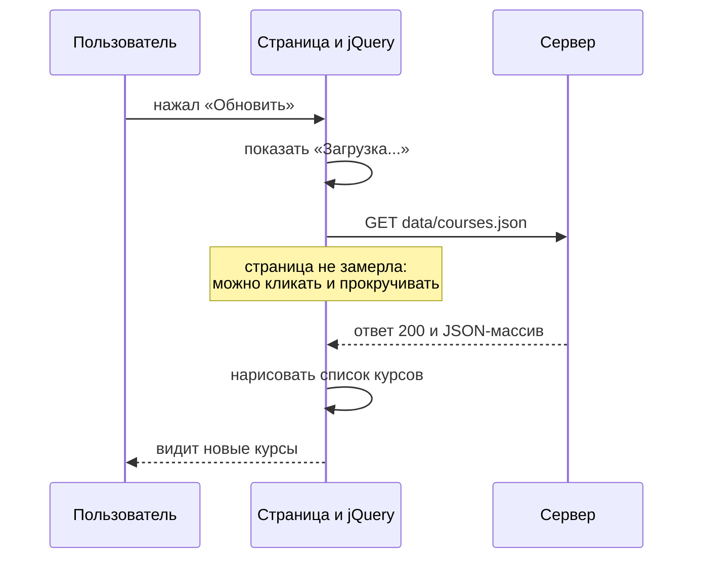
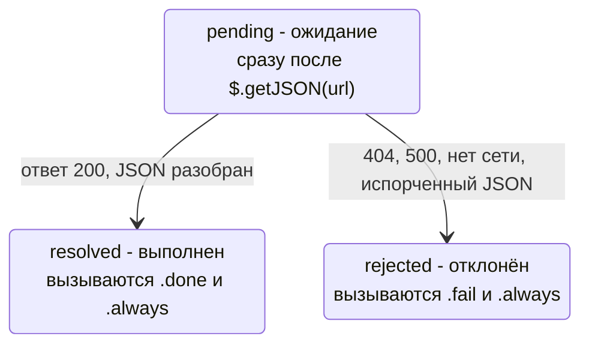
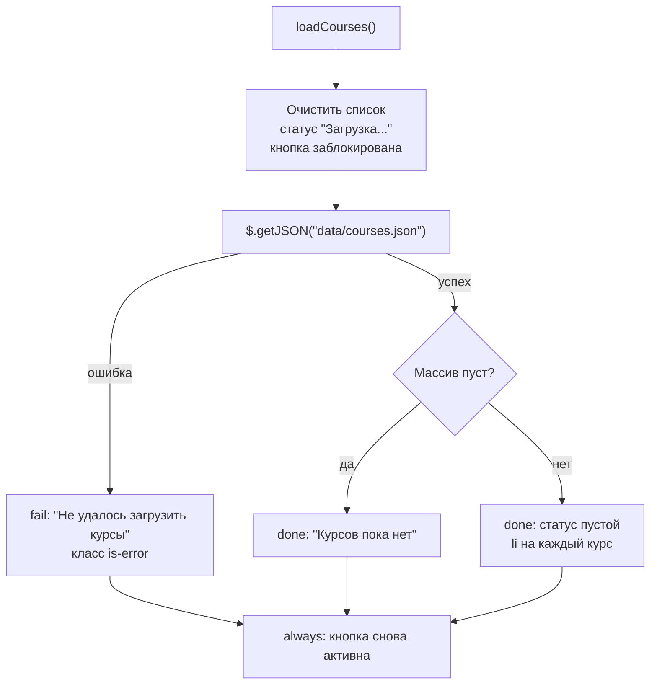

# AJAX - загрузка данных

[Содержание](../../README.md) · [← Назад](../../Lesson-8/ru/%D0%A4%D0%BE%D1%80%D0%BC%D1%8B.md) · [Вперёд →](../../Lesson-10/ru/%D0%9F%D0%BB%D0%B0%D0%B3%D0%B8%D0%BD%D1%8B%20%D0%B8%20%D0%B8%D1%82%D0%BE%D0%B3%D0%BE%D0%B2%D1%8B%D0%B9%20%D0%BF%D1%80%D0%BE%D0%B5%D0%BA%D1%82.md) · [RU](AJAX%20-%20%D0%B7%D0%B0%D0%B3%D1%80%D1%83%D0%B7%D0%BA%D0%B0%20%D0%B4%D0%B0%D0%BD%D0%BD%D1%8B%D1%85.md) · [EN](../en/AJAX%20-%20loading%20data.md) · [UZ](../uz/AJAX%20-%20ma'lumotlarni%20yuklash.md)

> **Связь с уроком 8:** вы научились собирать данные формы через `.val()` и `.serialize()`, проверять поля и блокировать кнопку отправки. Но данные пока никуда не уходили и ниоткуда не приходили. Сегодня страница начнёт **разговаривать с сервером**: загружать список курсов и отправлять заявку - без перезагрузки.

---

## Зачем это вам

Откройте любой интернет-магазин и нажмите «Показать ещё» - новые товары появятся, а страница не перезагрузится. Поставьте лайк в соцсети - счётчик изменится сразу. Введите город в поле погоды - прогноз подтянется сам. Во всех этих случаях скрипт **в фоне** просит у сервера данные и дорисовывает их на странице. Эта техника называется **AJAX**.

На сайтах с jQuery (а это огромное число сайтов на WordPress) запросы почти всегда написаны через `$.ajax`, `$.getJSON` и `.done()`. В курсе JavaScript вы уже делали это через `fetch` и `await`. Сегодня узнаете, как то же самое пишут на jQuery, и научитесь читать такой код в чужих проектах.

---

## Чему вы научитесь

- Объяснять, что такое AJAX, запрос и ответ, и как выглядят данные в формате JSON.
- Загружать JSON через `$.getJSON` и понимать, что возвращает запрос: объект **jqXHR**.
- Подписываться на результат: `.done()`, `.fail()`, `.always()`.
- Показывать четыре состояния интерфейса: загрузка, данные, «пусто» и ошибка.
- Ждать запрос jQuery через `await` внутри `async`-функции.
- Отправлять данные: `$.get`, `$.post` и универсальный `$.ajax` с настройками.
- Запускать страницу через Live Server, отключать кэш и читать `jqXHR.responseURL` (новое в 4.1).
- Сохранять загруженные данные в `localStorage` и показывать их без сети.

---

## Повторение: 3 вопроса из урока 8

1. Что вернёт `$("#signup-form").serialize()` для формы с полями `name = Анна` и `age = 20`?
2. Чем `.prop("checked")` отличается от `.attr("checked")`?
3. Зачем в обработчике `submit` вызывают `event.preventDefault()`?

Ответы - в конце урока.

---

## План урока

| Раздел | Что делаем |
| --- | --- |
| Что такое AJAX | Запрос и ответ без перезагрузки страницы |
| JSON | Формат данных и файл `data/courses.json` |
| `$.getJSON` и jqXHR | Первый запрос и «квитанция» о нём |
| `.done`, `.fail`, `.always` | Подписка на результат |
| Мини-задание 1 | Счётчик преподавателей из JSON |
| Три состояния | Загрузка, данные, пусто, ошибка |
| `await` с jQuery | Тот же запрос в стиле курса JavaScript |
| `$.get`, `$.post`, `$.ajax` | Отправка данных и настройки запроса |
| Где работает запрос | `file://`, Live Server, кэш, `responseURL` |
| `localStorage` | Сохранённая копия данных |
| Мини-задание 2 | Каталог, который работает без сети |
| Самостоятельная работа | Функция `loadCourses()` |

---

## Что такое AJAX

**Простыми словами:** страница в браузере - это посетитель ресторана, а сервер - кухня. Раньше, чтобы получить новое блюдо, посетителю приходилось выйти из ресторана и зайти заново (перезагрузить страницу). AJAX - это **официант**: вы продолжаете сидеть и разговаривать, официант относит заказ на кухню и приносит блюдо прямо к столу.

**AJAX** (Asynchronous JavaScript and XML - «асинхронный JavaScript и XML») - общее название техники: скрипт отправляет **запрос** на сервер и получает **ответ**, не перезагружая страницу. Буква X осталась от старого формата XML, сегодня данные почти всегда приходят в формате **JSON**.



**Как читать схему.** Сплошные стрелки - запросы, пунктирные - ответы. Пока сервер готовит ответ, страница продолжает работать: это и значит **асинхронно**. Когда ответ приходит, jQuery вызывает вашу функцию, и та рисует данные.

### Запрос и ответ

**Запрос** - это адрес (URL, например `data/courses.json`), метод (`GET` - получить, `POST` - отправить) и, при отправке, данные. **Ответ** - это код (`200` - успех, `404` - не найдено, `500` - ошибка сервера) и тело - сами данные, обычно JSON.

### `fetch` и jQuery: одна задача - разные инструменты

| Задача | Чистый JavaScript (курс JS) | jQuery |
| --- | --- | --- |
| Загрузить JSON | `await fetch(url)` + `await response.json()` | `$.getJSON(url)` |
| Что вернётся сразу | Промис (Promise) | Объект **jqXHR** |
| Успех | код после `await` | `.done(функция)` |
| Ошибка | `catch` | `.fail(функция)` |
| В любом случае | `finally` | `.always(функция)` |
| Ответ 404 считается ошибкой | Нет, проверяем `response.ok` вручную | **Да**, сразу попадает в `.fail` |

> **Важно:** AJAX есть только в **полной** сборке jQuery. В slim-сборке `$.ajax` и `$.getJSON` отсутствуют - вы получите `TypeError: $.getJSON is not a function`.

---

## JSON - формат данных

**JSON** (JavaScript Object Notation) - текстовая запись массивов и объектов. Вы встречали его в курсе JavaScript: так данные хранятся в файлах и передаются по сети.

Файл `data/courses.json` рядом со страницей:

```json
[
    { "title": "HTML", "lessons": 10 },
    { "title": "CSS", "lessons": 10 },
    { "title": "JavaScript", "lessons": 12 }
]
```

| Правило JSON | Правильно | Ошибка |
| --- | --- | --- |
| Ключи - в двойных кавычках | `{ "title": "HTML" }` | `{ title: "HTML" }` |
| Строки - только двойные кавычки | `"HTML"` | `'HTML'` |
| Без запятой после последнего элемента | `[1, 2, 3]` | `[1, 2, 3,]` |

`$.getJSON` сам превращает текст ответа в массив или объект - вызывать `JSON.parse` не нужно. А если JSON испорчен, запрос завершится **ошибкой** с текстом `parsererror`.

> **Важно:** функция `$.parseJSON` удалена в jQuery 4.0. Если увидите её в старом коде, заменяйте на `JSON.parse`.

---

## `$.getJSON` и объект jqXHR

```js
const request = $.getJSON("data/courses.json");
console.log(request.state()); // "pending" - ответа ещё нет
```

`$.getJSON(url)` отправляет запрос `GET` и **сразу**, не дожидаясь ответа, возвращает объект **jqXHR** (jQuery XMLHttpRequest).

**Простыми словами:** jqXHR - это **трек-номер посылки**. Посылка ещё в пути, а номер у вас уже на руках. По нему можно узнать статус («в пути», «доставлено», «не доставлено») и подписаться на уведомление: «Когда доставят - сообщите мне».

| Свойство или метод jqXHR | Что содержит | Пример |
| --- | --- | --- |
| `.state()` | Состояние запроса | `"pending"`, `"resolved"`, `"rejected"` |
| `.status` | Код ответа | `200`, `404`, `0` - ответа не было |
| `.statusText` | Код словами | `"OK"`, `"Not Found"` |
| `.responseJSON` | Разобранный JSON ответа | Массив курсов |
| `.responseURL` | Адрес, откуда **на самом деле** пришёл ответ (новое в 4.1) | `"http://127.0.0.1:5500/data/courses.json"` |

Почему результат нельзя просто присвоить переменной:

```js
const courses = $.getJSON("data/courses.json");
console.log(courses.length); // undefined - это трек-номер, а не посылка
```

---

## Deferred: `.done`, `.fail`, `.always`

jqXHR устроен на основе **Deferred** («отложенный») - объекта jQuery, похожего на промис из курса JavaScript. У него три состояния:



**Как читать схему.** Запрос начинает в состоянии `pending` («ожидание») и переходит **ровно один раз** либо в `resolved` («выполнен»), либо в `rejected` («отклонён»). После этого состояние больше не меняется. Каждая подписка срабатывает один раз.

**Простыми словами:** вы оформили доставку и подписались на SMS. `.done` - «Посылка доставлена», `.fail` - «Доставка не удалась», `.always` - «Заказ закрыт» (приходит в любом случае). Если подписаться **после** доставки, SMS придёт сразу.

```js
$.getJSON("data/courses.json")
    .done((courses) => {
        console.log("Курсов:", courses.length);
    })
    .fail((jqXHR, textStatus) => {
        console.log("Ошибка:", jqXHR.status, textStatus);
    })
    .always(() => {
        console.log("Запрос завершён");
    });
```

Каждый метод возвращает тот же jqXHR, поэтому их пишут **цепочкой** - как в уроке 1.

| Метод | Когда вызывается | Что получает функция |
| --- | --- | --- |
| `.done(fn)` | Успех | `(data, textStatus, jqXHR)` - данные уже разобраны |
| `.fail(fn)` | Ошибка | `(jqXHR, textStatus, errorThrown)` |
| `.always(fn)` | В любом случае, после `done` или `fail` | Те же аргументы, что у сработавшего |

| `textStatus` в `.fail` | Что случилось |
| --- | --- |
| `"error"` | Сервер ответил ошибкой (`404`, `500`) или сети нет (`status` равен `0`) |
| `"parsererror"` | Ответ пришёл, но это не правильный JSON |
| `"timeout"` | Сервер не успел ответить за время `timeout` |
| `"abort"` | Запрос отменили методом `jqXHR.abort()` |

### В каком порядке выполняется код

```js
console.log("Шаг 1: отправляем запрос");

$.getJSON("data/courses.json")
    .done(() => console.log("Шаг 3: ответ пришёл"))
    .always(() => console.log("Шаг 4: запрос закрыт"));

console.log("Шаг 2: код идёт дальше");
```

| Шаг | Что происходит | Значение / состояние страницы |
| --- | --- | --- |
| 1 | `console.log` | В консоли «Шаг 1» |
| 2 | `$.getJSON` отправляет запрос и сразу возвращает jqXHR | `state()` = `"pending"` |
| 3 | `.done` и `.always` **запоминают** функции, но не вызывают их | Ничего не выведено |
| 4 | Следующая строка | В консоли «Шаг 2» - раньше ответа! |
| 5 | Через несколько миллисекунд приходит ответ `200` | `state()` = `"resolved"` |
| 6 | jQuery вызывает функцию из `.done`, затем из `.always` | «Шаг 3», «Шаг 4» |

> **Важно:** весь код, которому нужны данные, пишут **внутри** `.done`. Строки после `$.getJSON` выполняются раньше, чем придёт ответ.

---

## Мини-задание 1

Файл `data/teachers.json` содержит массив преподавателей: `[{ "name": "Анна" }, { "name": "Тимур" }]`. На странице есть `<p id="teacher-count"></p>`.

1. Загрузите файл через `$.getJSON`.
2. В `.done` запишите в `#teacher-count` текст `Преподавателей: 2` (число - длина массива).
3. В `.fail` запишите `Ошибка загрузки: 404`, где число - `jqXHR.status`.
4. В `.always` выведите в консоль `Запрос завершён`.
5. Проверьте ошибку: поменяйте адрес на `data/teacher.json`.

---

## Три состояния: загрузка, данные, пусто, ошибка

Пользователь не видит запросов. Он видит только страницу, и она должна честно рассказывать, что происходит. Хороший интерфейс показывает одно из четырёх состояний:

| Состояние | Что видит пользователь | Где в коде |
| --- | --- | --- |
| Загрузка | «Загрузка...», кнопка заблокирована | Перед `$.getJSON` |
| Данные | Список курсов | `.done`, массив не пуст |
| Пусто | «Курсов пока нет» | `.done`, массив пуст |
| Ошибка | «Не удалось загрузить курсы» | `.fail` |

Разметка:

```html
<button id="reload-btn" type="button">Обновить</button>
<p id="courses-status" role="status"></p>
<ul id="course-list"></ul>
```

Атрибут `role="status"` подсказывает экранной читалке, что текст в абзаце нужно объявить вслух: незрячий пользователь услышит «Загрузка...» и сообщение об ошибке.

```js
const $list = $("#course-list");
const $status = $("#courses-status");
const $reloadBtn = $("#reload-btn");

function loadCourses() {
    $list.empty();
    $status.text("Загрузка...").removeClass("is-error");
    $reloadBtn.prop("disabled", true);

    $.getJSON("data/courses.json")
        .done((courses) => {
            if (courses.length === 0) {
                $status.text("Курсов пока нет");
                return;
            }
            $status.text("");
            for (const course of courses) {
                $("<li>")
                    .addClass("course")
                    .text(`${course.title} - уроков: ${course.lessons}`)
                    .appendTo($list);
            }
        })
        .fail(() => {
            $status.text("Не удалось загрузить курсы").addClass("is-error");
        })
        .always(() => {
            $reloadBtn.prop("disabled", false);
        });
}

loadCourses();
$reloadBtn.on("click", loadCourses);
```



**Как читать схему.** Любой путь начинается с состояния «Загрузка» и заканчивается в `always`. Поэтому разблокировку кнопки пишут **один раз** в `.always`, а не повторяют в `.done` и `.fail`.

### Нажатие «Обновить», когда сервер не отвечает

| Шаг | Что происходит | Значение / состояние страницы |
| --- | --- | --- |
| 1 | Клик по `#reload-btn` вызывает `loadCourses` | На странице 3 курса с прошлой загрузки |
| 2 | `$list.empty()` | Список пуст |
| 3 | `$status.text("Загрузка...")`, `.prop("disabled", true)` | «Загрузка...», кнопку не нажать второй раз |
| 4 | `$.getJSON` отправил запрос | jqXHR в состоянии `pending` |
| 5 | Сеть пропала: запрос отклонён, `status` = `0` | `rejected` |
| 6 | Срабатывает `.fail` | «Не удалось загрузить курсы», красный цвет из класса `is-error` |
| 7 | Срабатывает `.always` | Кнопка снова активна - можно попробовать ещё раз |

Почему в начале очищаем список: без `$list.empty()` после ошибки на странице остались бы старые курсы **рядом** с сообщением об ошибке, а после второй успешной загрузки курсы бы удвоились.

> **Важно:** название курса пришло с сервера - это чужие данные. Вставляйте их через `.text()`, как в уроке 5. Запись `$("<li>" + course.title + "</li>")` превратит строку `` в настоящий тег.

---

## `await` с запросом jQuery

В курсе JavaScript вы писали запросы через `async` / `await`. jqXHR понимает `await`: у него есть метод `.then`, а `await` работает с любым объектом, у которого он есть.

```js
async function loadCourses() {
    $status.text("Загрузка...");
    try {
        const courses = await $.getJSON("data/courses.json");
        $status.text(`Курсов: ${courses.length}`);
    } catch (jqXHR) {
        $status.text(`Ошибка ${jqXHR.status}`);
    } finally {
        $reloadBtn.prop("disabled", false);
    }
}
```

| Deferred | `async` / `await` |
| --- | --- |
| `.done((courses) => {...})` | `const courses = await $.getJSON(url);` |
| `.fail((jqXHR) => {...})` | `catch (jqXHR) {...}` - в `catch` попадает сам jqXHR |
| `.always(() => {...})` | `finally {...}` |

**Простыми словами:** это один и тот же трек-номер. Можно подписаться на SMS (`.done`), а можно сесть у двери и ждать курьера (`await`). Посылка придёт одна и та же.

| Чем отличаются | `.done` | `await` / `.then` |
| --- | --- | --- |
| Если запрос **уже** завершён | Функция вызывается **сразу**, в той же строке | Продолжение выполнится чуть позже, после текущего кода |

В курсе мы пишем `.done` / `.fail` / `.always`: этот стиль чаще всего встречается в проектах на jQuery, и задание урока проверяет именно его. Но `await` с jQuery тоже правильный код.

---

## `$.get`, `$.post` и `$.ajax`

**Простыми словами:** `$.getJSON`, `$.get` и `$.post` - блюда из меню с готовым рецептом. `$.ajax` - заказ «с особыми пожеланиями»: вы сами указываете метод, формат, время ожидания и всё остальное. На самом деле меню - лишь короткие записи, внутри каждая вызывает `$.ajax`.

| Запись | Метод | Что делает |
| --- | --- | --- |
| `$.getJSON(url)` | GET | Получить JSON и разобрать |
| `$.get(url, data)` | GET | Получить что угодно: формат угадывается по ответу сервера |
| `$.post(url, data)` | POST | Отправить данные на сервер |
| `$.ajax({ ... })` | любой | Полная настройка |

### Отправка формы: `$.post` и `.serialize()`

Форма из урока 8 наконец отправляет данные:

```js
$("#signup-form").on("submit", function (event) {
    event.preventDefault();
    const $form = $(this);

    $.post("https://jsonplaceholder.typicode.com/posts", $form.serialize())
        .done((answer) => {
            $("#form-message").text(`Заявка принята, номер ${answer.id}`);
            $form[0].reset();
        })
        .fail(() => {
            $("#form-message").text("Не удалось отправить. Попробуйте позже.");
        });
});
```

`jsonplaceholder.typicode.com` - бесплатный учебный сервер: принимает `POST`, отвечает объектом с новым `id`, но ничего не сохраняет. Live Server умеет только отдавать файлы, поэтому для `POST` нужен такой сервер.

### `$.ajax` с настройками

```js
$.ajax({
    url: "https://jsonplaceholder.typicode.com/posts",
    method: "POST",
    contentType: "application/json",
    data: JSON.stringify({ title: "jQuery", lessons: 10 }),
    dataType: "json",
    timeout: 5000
})
    .done((answer) => console.log("Создано:", answer.id))
    .fail((jqXHR, textStatus) => console.log("Ошибка:", textStatus));
```

| Настройка | Что задаёт | Пример |
| --- | --- | --- |
| `url` | Адрес | `"data/courses.json"` |
| `method` | Метод запроса | `"GET"` (по умолчанию), `"POST"`, `"DELETE"` |
| `data` | Что отправить | Объект `{ q: "css" }`, строка `.serialize()`, `JSON.stringify(...)` |
| `dataType` | Какой формат ждём в ответе | `"json"`, `"text"` |
| `contentType` | В каком формате отправляем | `"application/json"` - если в `data` строка JSON |
| `timeout` | Сколько ждать, мс | `5000` - потом `.fail` с `"timeout"` |
| `cache` | Разрешить кэш браузера | `false` - всегда свежие данные |

> **Важно:** в jQuery 4 `$.ajax` больше не превращает JSON-запрос на чужой сайт в устаревший формат JSONP автоматически: старый код на jQuery 3 мог из-за этого сломаться.

---

## Где работает запрос: `file://`, Live Server, кэш и `responseURL`

### `file://` и Live Server

Если открыть `index.html` двойным кликом, адрес в браузере начнётся с `file:///C:/...`. Браузер **запрещает** скриптам с таких страниц загружать файлы: в консоли будет ошибка CORS, а в `.fail` - `jqXHR.status === 0`.

**Простыми словами:** `file://` - это книга, которую вы читаете дома. AJAX - звонок в библиотеку. Из дома позвонить нельзя: у страницы нет «телефона», то есть адреса сайта. Live Server даёт ей адрес `http://127.0.0.1:5500` - и звонки начинают проходить.

| Как открыта страница | Адрес | `$.getJSON("data/courses.json")` |
| --- | --- | --- |
| Двойной клик | `file:///.../index.html` | `.fail`, `status` = `0` |
| VS Code → Live Server → «Go Live» | `http://127.0.0.1:5500/index.html` | Работает |
| GitHub Pages | `https://имя.github.io/сайт/` | Работает |

### Кэш

Браузер может запомнить ответ на `GET`-запрос и при следующем обращении отдать сохранённую копию, не спрашивая сервер. Это быстро, но иногда вы обновили `courses.json`, а страница показывает старый список.

```js
$.ajax({
    url: "data/courses.json",
    dataType: "json",
    cache: false
}).done((courses, textStatus, jqXHR) => {
    console.log(jqXHR.responseURL);
    // "http://127.0.0.1:5500/data/courses.json?_=1795066240113"
});
```

С `cache: false` jQuery дописывает к адресу параметр `_=` с текущим временем. Каждый адрес получается новым, и браузер вынужден спросить сервер.

### `jqXHR.responseURL` - новое в jQuery 4.1

`responseURL` - **полный адрес, с которого на самом деле пришёл ответ**. Он может отличаться от того, что вы написали:

| Вы запросили | `responseURL` | Почему |
| --- | --- | --- |
| `data/courses.json` | `http://127.0.0.1:5500/data/courses.json` | Относительный адрес дополнен до полного |
| `data/courses.json` с `cache: false` | `...courses.json?_=1795066240113` | jQuery добавил параметр против кэша |
| `old/courses.json` (сервер перенаправил) | `http://127.0.0.1:5500/data/courses.json` | Сервер ответил «переехало сюда» |

Теперь этот адрес есть прямо у jqXHR - и в `.done`, и в `.fail`. При отладке сразу видно, **куда** на самом деле ушёл запрос.

---

## Сохранение в `localStorage`

Данные с сервера можно запомнить в браузере, чтобы при следующем открытии или без сети показать хотя бы последнюю копию.

**Простыми словами:** это как скачать карту города на телефон перед поездкой. Пока есть интернет - карта свежая. Пропал интернет - вы видите вчерашнюю, но она лучше, чем пустой экран.

```js
// Сохранить после успешной загрузки
localStorage.setItem("courses", JSON.stringify(courses));

// Прочитать сохранённое: массив или пустой массив
function readSavedCourses() {
    try {
        const saved = JSON.parse(localStorage.getItem("courses"));
        return Array.isArray(saved) ? saved : [];
    } catch (error) {
        return [];
    }
}
```

`Array.isArray` нужен, потому что `JSON.parse(null)` (сохранения ещё не было) возвращает `null`, а не массив. Испорченную строку вроде `"[{oops"` поймает `catch`.

> **Важно:** в `localStorage` можно класть только строки - массив превращаем через `JSON.stringify`. И не храните там пароли и токены: их прочитает любой скрипт на странице.

---

### Попробуйте сломать

1. Откройте страницу двойным кликом (через `file://`). Что напишет консоль и какой `jqXHR.status` придёт в `.fail`?
2. Поставьте запятую после последнего элемента в `courses.json`. Какой `textStatus` получит `.fail`?
3. Перенесите `console.log(courses.length)` из `.done` на строку после `$.getJSON`. Что выведется и почему?
4. Уберите `$list.empty()` и нажмите «Обновить» три раза. Сколько курсов в списке?
5. В DevTools → **Network** включите режим **Offline** и нажмите «Обновить». Что покажет страница? Вернулась ли кнопка в рабочее состояние?

### Частые ошибки новичков

| Ошибка | Что получится | Как исправить |
| --- | --- | --- |
| `const courses = $.getJSON(url);` и работа с `courses` как с массивом | `undefined`, ничего не рисуется | Данные доступны только в `.done` или после `await` |
| Код, которому нужны данные, после `$.getJSON` | Выполняется до ответа | Переносим внутрь `.done` |
| Страница открыта как `file://` | `.fail`, `status` = `0`, ошибка CORS | Live Server |
| Нет `.fail` | При ошибке навсегда «Загрузка...» | Всегда обрабатываем ошибку |
| Разблокировка кнопки только в `.done` | После ошибки кнопка мертва | Разблокировка в `.always` |
| Нет `$list.empty()` перед загрузкой | Список удваивается | Очищаем в начале функции |
| `$("<li>" + course.title + "</li>")` | Чужая разметка становится тегами | `$("<li>").text(course.title)` |
| `localStorage.setItem("courses", courses)` | Сохраняется строка `"[object Object],..."` | `JSON.stringify(courses)` |
| Slim-сборка | `$.getJSON is not a function` | Полная сборка `jquery-4.1.0.min.js` |

---

## Мини-задание 2

Доработайте `loadCourses` из раздела «Три состояния» так, чтобы каталог работал без сети:

1. В `.done` сохраняйте массив в `localStorage` под ключом `courses`.
2. Вынесите отрисовку в функцию `renderCourses(list)`.
3. Добавьте функцию `readSavedCourses()` из раздела про `localStorage`.
4. В `.fail`: если сохранённая копия не пуста - нарисуйте её и напишите в статусе `Нет связи. Показана сохранённая копия.`; иначе - прежнее сообщение об ошибке.

Проверьте: загрузите страницу с сетью, затем включите **Offline** в DevTools и нажмите «Обновить».

---

## Итоги урока: шпаргалка

| Задача | Запись |
| --- | --- |
| Загрузить JSON | `$.getJSON("data/courses.json")` |
| Успех / ошибка / в любом случае | `.done((data) => {...}).fail((jqXHR) => {...}).always(() => {...})` |
| Код ответа | `jqXHR.status` - `200`, `404`, `0` |
| Реальный адрес ответа (4.1) | `jqXHR.responseURL` |
| Ждать через `await` | `const data = await $.getJSON(url);` в `async`-функции, ошибка - в `catch` |
| Получить данные | `$.get(url, { q: "css" })` |
| Отправить форму | `$.post(url, $form.serialize())` |
| Полная настройка | `$.ajax({ url, method, data, dataType, timeout, cache })` |
| Отключить кэш | `cache: false` |
| Сохранить / прочитать | `localStorage.setItem(k, JSON.stringify(v))` / `JSON.parse(localStorage.getItem(k))` |
| Запуск на компьютере | Live Server, не `file://` |

---

## Самостоятельная работа

### Часть 1. Задание в IDE (засчитывается платформой)

На странице есть кнопка `#reload-btn`, абзац `#courses-status` и пустой список `#course-list`. Сервер по адресу `data/courses.json` отдаёт массив курсов вида `{ title: "HTML", lessons: 10 }` (в IDE сервер подменён тестовыми данными, код пишется как для настоящего). Напишите функцию `loadCourses()`:

1. **Загрузка.** Очистите `#course-list`, запишите в `#courses-status` текст `Загрузка...`, уберите у него класс `is-error` и заблокируйте `#reload-btn` (`.prop("disabled", true)`).
2. **Запрос.** Вызовите `$.getJSON("data/courses.json")` и обработайте результат через `.done`, `.fail` и `.always` (не через `await`).
3. **Данные и пусто (`.done`).** Сохраните массив в `localStorage` под ключом `courses` (через `JSON.stringify`). Если массив пуст - статус `Курсов пока нет`. Иначе статус - пустая строка, а для каждого курса добавьте в список `li` с классом `course` и текстом `HTML - уроков: 10`, созданный через `$("<li>")` и `.text()`.
4. **Ошибка (`.fail`).** Статус `Не удалось загрузить курсы` и класс `is-error`.
5. **Завершение (`.always`).** Разблокируйте кнопку.
6. Вызовите `loadCourses()` один раз при запуске и подключите её к клику по `#reload-btn` через `.on()`.

`document.querySelector`, `innerHTML`, `.html()`, `fetch` и `await` не используйте.

Что проверяет платформа: состояние «Загрузка...» и заблокированную кнопку, пока ответа нет; адрес запроса; число, текст и класс пунктов; пустой статус после успеха; состояние «пусто»; состояние ошибки с классом и разблокированной кнопкой; что повторная загрузка не удваивает список, а ошибка после успеха убирает старые курсы; что название курса выводится как текст; запись в `localStorage`; использование `.done`, `.fail`, `.always`; отсутствие ошибок.

### Часть 2. Проект на компьютере

1. Создайте на своём сайте из курсов HTML/CSS/JS файл `data/projects.json` со своими проектами (название, ссылка, год) и откройте сайт через Live Server.
2. Загрузите его через `$.getJSON` и отрисуйте карточки с состояниями «Загрузка», «Пусто» и «Ошибка».
3. Сохраняйте полученный массив в `localStorage` и показывайте копию, если запрос не удался.
4. Подключите форму обратной связи из урока 8 к `$.post` на `jsonplaceholder.typicode.com/posts`, покажите номер заявки и выведите в консоль `jqXHR.responseURL`.

### Критерии готовности

- [ ] Задание в IDE засчитано.
- [ ] Сайт открыт через Live Server, в консоли нет ошибок CORS.
- [ ] Есть все состояния: загрузка, данные, пусто, ошибка; кнопка разблокируется в `.always`.
- [ ] Данные с сервера выводятся через `.text()`, а не склейкой HTML-строк.
- [ ] Вы можете объяснить, почему `const data = $.getJSON(url)` не даёт массив.

---

## Вопросы для самопроверки

1. Что такое AJAX и чем он лучше перезагрузки страницы?
2. Что возвращает `$.getJSON` сразу после вызова? Почему это не данные?
3. Какие три состояния есть у Deferred и в каком из них вызывается `.always`?
4. Какие аргументы получает функция в `.done` и в `.fail`?
5. Почему разблокировку кнопки пишут в `.always`, а не в `.done`?
6. Как дождаться запроса jQuery через `await` и что попадёт в `catch`?
7. Чем `$.post` отличается от `$.getJSON` и когда нужен `$.ajax`?
8. Почему запрос не работает, если открыть страницу двойным кликом, и как это исправить?
9. Что делает настройка `cache: false` и что покажет `jqXHR.responseURL`?
10. Как сохранить массив в `localStorage` и безопасно прочитать его обратно?

После вопросов пройдите **тест урока** на платформе: 12 вопросов, порог 70%.

---

## Что дальше

Вы прошли все основные возможности jQuery: выбор и обход элементов, содержимое, классы, создание элементов, события, эффекты, формы и запросы к серверу. В уроке 10 научимся **писать свои плагины** через `$.fn` - упаковывать повторяющийся код в метод, который вызывается как `$(".field").charCounter()`, - разберём, что удалено в jQuery 4, и соберём итоговый проект.

---

## Ответы

**Повторение**

1. Строку `name=%D0%90%D0%BD%D0%BD%D0%B0&age=20` - поля формы в формате «имя=значение», соединённые `&`, кириллица закодирована.
2. `.prop("checked")` - текущее состояние флажка (`true` / `false`), `.attr("checked")` - исходный атрибут из HTML, который не меняется от клика.
3. Чтобы браузер не отправил форму сам и не перезагрузил страницу - данные обрабатывает наш код.

**Мини-задание 1**

```js
$.getJSON("data/teachers.json")
    .done((teachers) => {
        $("#teacher-count").text(`Преподавателей: ${teachers.length}`);
    })
    .fail((jqXHR) => {
        $("#teacher-count").text(`Ошибка загрузки: ${jqXHR.status}`);
    })
    .always(() => {
        console.log("Запрос завершён");
    });
```

**Мини-задание 2**

```js
const $list = $("#course-list");
const $status = $("#courses-status");
const $reloadBtn = $("#reload-btn");

function renderCourses(list) {
    for (const course of list) {
        $("<li>")
            .addClass("course")
            .text(`${course.title} - уроков: ${course.lessons}`)
            .appendTo($list);
    }
}

function readSavedCourses() {
    try {
        const saved = JSON.parse(localStorage.getItem("courses"));
        return Array.isArray(saved) ? saved : [];
    } catch (error) {
        return [];
    }
}

function loadCourses() {
    $list.empty();
    $status.text("Загрузка...").removeClass("is-error");
    $reloadBtn.prop("disabled", true);

    $.getJSON("data/courses.json")
        .done((courses) => {
            localStorage.setItem("courses", JSON.stringify(courses));
            if (courses.length === 0) {
                $status.text("Курсов пока нет");
                return;
            }
            $status.text("");
            renderCourses(courses);
        })
        .fail(() => {
            const saved = readSavedCourses();
            if (saved.length > 0) {
                $status.text("Нет связи. Показана сохранённая копия.");
                renderCourses(saved);
                return;
            }
            $status.text("Не удалось загрузить курсы").addClass("is-error");
        })
        .always(() => {
            $reloadBtn.prop("disabled", false);
        });
}

loadCourses();
$reloadBtn.on("click", loadCourses);
```

**Вопросы для самопроверки**

1. Техника, при которой скрипт запрашивает данные у сервера в фоне и обновляет часть страницы без перезагрузки. Пользователь не теряет введённое и не ждёт загрузки всей страницы.
2. Объект jqXHR - «трек-номер» запроса. Ответа в момент вызова ещё нет, данные придут позже в `.done`.
3. `pending`, `resolved`, `rejected`. `.always` вызывается после перехода в любое из двух конечных состояний.
4. `.done(data, textStatus, jqXHR)` - уже разобранные данные; `.fail(jqXHR, textStatus, errorThrown)` - сам запрос, тип ошибки и её текст.
5. `.always` срабатывает и при успехе, и при ошибке. Если разблокировать только в `.done`, после ошибки кнопка останется заблокированной.
6. `const data = await $.getJSON(url);` внутри `async`-функции, в `try` / `catch`. В `catch` попадает jqXHR, у него есть `status`.
7. `$.post` отправляет данные методом POST, `$.getJSON` получает JSON методом GET. `$.ajax` нужен для особых настроек: метод, формат, `contentType`, `timeout`, `cache`, заголовки.
8. С адреса `file://` браузер запрещает загрузку файлов (CORS), `status` = `0`. Открыть страницу через Live Server или опубликовать на GitHub Pages.
9. Добавляет к адресу `_=время`, чтобы браузер не отдал старую копию из кэша. `responseURL` покажет полный адрес ответа - с этим параметром и после перенаправлений.
10. `localStorage.setItem("courses", JSON.stringify(courses))`; читать через `JSON.parse(localStorage.getItem("courses"))` внутри `try` / `catch` и проверять `Array.isArray`.

[Содержание](../../README.md) · [← Назад](../../Lesson-8/ru/%D0%A4%D0%BE%D1%80%D0%BC%D1%8B.md) · [Вперёд →](../../Lesson-10/ru/%D0%9F%D0%BB%D0%B0%D0%B3%D0%B8%D0%BD%D1%8B%20%D0%B8%20%D0%B8%D1%82%D0%BE%D0%B3%D0%BE%D0%B2%D1%8B%D0%B9%20%D0%BF%D1%80%D0%BE%D0%B5%D0%BA%D1%82.md) · [RU](AJAX%20-%20%D0%B7%D0%B0%D0%B3%D1%80%D1%83%D0%B7%D0%BA%D0%B0%20%D0%B4%D0%B0%D0%BD%D0%BD%D1%8B%D1%85.md) · [EN](../en/AJAX%20-%20loading%20data.md) · [UZ](../uz/AJAX%20-%20ma'lumotlarni%20yuklash.md)
