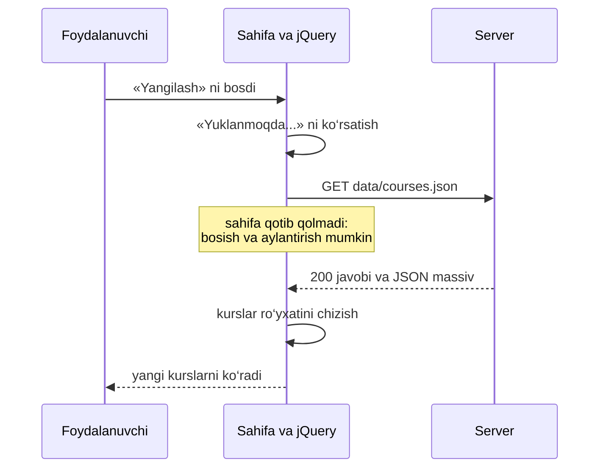
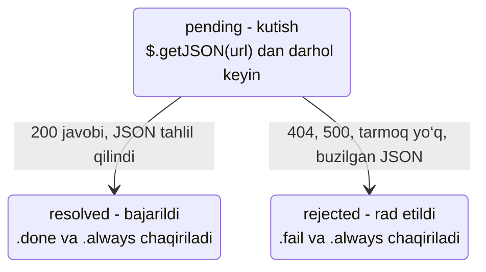
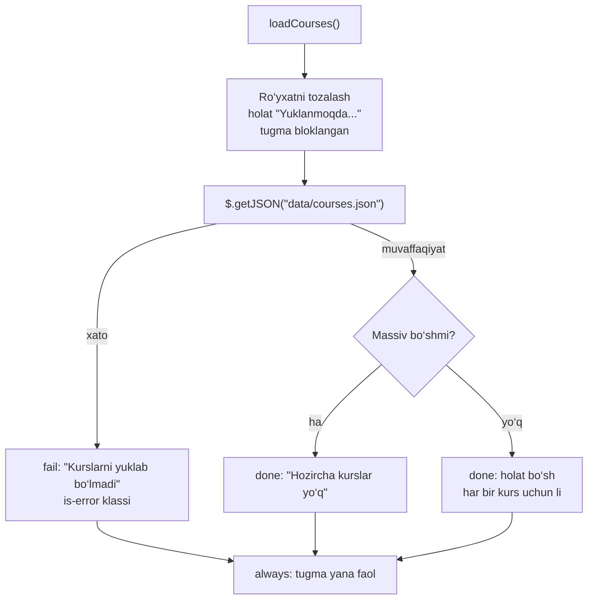

# AJAX - ma’lumotlarni yuklash

[Mundarija](../../README.md) · [← Orqaga](../../Lesson-8/uz/Formalar.md) · [Keyingi →](../../Lesson-10/uz/Plaginlar%20va%20yakuniy%20loyiha.md) · [RU](../ru/AJAX%20-%20%D0%B7%D0%B0%D0%B3%D1%80%D1%83%D0%B7%D0%BA%D0%B0%20%D0%B4%D0%B0%D0%BD%D0%BD%D1%8B%D1%85.md) · [EN](../en/AJAX%20-%20loading%20data.md) · [UZ](AJAX%20-%20ma'lumotlarni%20yuklash.md)

> **8-dars bilan bog‘liqlik:** siz forma ma’lumotlarini `.val()` va `.serialize()` orqali yig‘ishni, maydonlarni tekshirishni va yuborish tugmasini bloklashni o‘rgandingiz. Lekin ma’lumotlar hozircha hech qayerga ketmas va hech qayerdan kelmas edi. Bugun sahifa **server bilan gaplasha** boshlaydi: kurslar ro‘yxatini yuklaydi va arizani yuboradi - qayta yuklanmasdan.

---

## Bu sizga nima uchun kerak

Istalgan internet-do‘konni oching va «Yana ko‘rsatish» tugmasini bosing - yangi tovarlar paydo bo‘ladi, sahifa esa qayta yuklanmaydi. Ijtimoiy tarmoqda layk bosing - hisoblagich darhol o‘zgaradi. Ob-havo maydoniga shahar nomini kiriting - prognoz o‘zi yuklanadi. Bu holatlarning barchasida skript **fonda** serverdan ma’lumot so‘raydi va ularni sahifaga chizib qo‘yadi. Bu usul **AJAX** deb ataladi.

jQuery’li saytlarda (bular esa WordPress’dagi juda ko‘p saytlar) so‘rovlar deyarli doim `$.ajax`, `$.getJSON` va `.done()` orqali yozilgan. JavaScript kursida siz buni `fetch` va `await` orqali qilgansiz. Bugun xuddi shu narsa jQuery’da qanday yozilishini bilib olasiz va bunday kodni boshqalarning loyihalarida o‘qishni o‘rganasiz.

---

## Nimani o‘rganasiz

- AJAX, so‘rov va javob nima ekanini, JSON formatidagi ma’lumotlar qanday ko‘rinishini tushuntirish.
- JSON’ni `$.getJSON` orqali yuklash va so‘rov nimani qaytarishini tushunish: **jqXHR** obyekti.
- Natijaga obuna bo‘lish: `.done()`, `.fail()`, `.always()`.
- Interfeysning to‘rt holatini ko‘rsatish: yuklanish, ma’lumotlar, «bo‘sh» va xato.
- jQuery so‘rovini `async` funksiya ichida `await` orqali kutish.
- Ma’lumot yuborish: `$.get`, `$.post` va sozlamali universal `$.ajax`.
- Sahifani Live Server orqali ishga tushirish, keshni o‘chirish va `jqXHR.responseURL` ni o‘qish (4.1 dagi yangilik).
- Yuklangan ma’lumotlarni `localStorage` ga saqlash va ularni tarmoqsiz ko‘rsatish.

---

## Takrorlash: 8-darsdan 3 savol

1. `name = Anna` va `age = 20` maydonli forma uchun `$("#signup-form").serialize()` nimani qaytaradi?
2. `.prop("checked")` `.attr("checked")` dan nimasi bilan farq qiladi?
3. `submit` ishlovchisida nima uchun `event.preventDefault()` chaqiriladi?

Javoblar - dars oxirida.

---

## Reja

| Bo‘lim | Nima qilamiz |
| --- | --- |
| AJAX nima | Sahifani qayta yuklamasdan so‘rov va javob |
| JSON | Ma’lumotlar formati va `data/courses.json` fayli |
| `$.getJSON` va jqXHR | Birinchi so‘rov va u haqidagi «kvitansiya» |
| `.done`, `.fail`, `.always` | Natijaga obuna bo‘lish |
| Mini-topshiriq 1 | JSON’dan o‘qituvchilar hisoblagichi |
| Uch holat | Yuklanish, ma’lumotlar, bo‘sh, xato |
| jQuery bilan `await` | O‘sha so‘rov JavaScript kursi uslubida |
| `$.get`, `$.post`, `$.ajax` | Ma’lumot yuborish va so‘rov sozlamalari |
| So‘rov qayerda ishlaydi | `file://`, Live Server, kesh, `responseURL` |
| `localStorage` | Ma’lumotlarning saqlangan nusxasi |
| Mini-topshiriq 2 | Tarmoqsiz ishlaydigan katalog |
| Mustaqil ish | `loadCourses()` funksiyasi |

---

## AJAX nima

**Oddiy so‘z bilan:** brauzerdagi sahifa - restorandagi mehmon, server esa - oshxona. Ilgari yangi taom olish uchun mehmon restorandan chiqib, qaytadan kirishi kerak edi (sahifani qayta yuklash). AJAX - bu **ofitsiant**: siz o‘tirib suhbatlashishda davom etasiz, ofitsiant esa buyurtmani oshxonaga olib boradi va taomni to‘g‘ri stolingizga olib keladi.

**AJAX** (Asynchronous JavaScript and XML - «asinxron JavaScript va XML») - usulning umumiy nomi: skript serverga **so‘rov** yuboradi va sahifani qayta yuklamasdan **javob** oladi. X harfi eski XML formatidan qolgan, bugun ma’lumotlar deyarli doim **JSON** formatida keladi.



**Sxemani qanday o‘qish kerak.** Uzluksiz strelkalar - so‘rovlar, punktir strelkalar - javoblar. Server javob tayyorlayotganda sahifa ishlashda davom etadi: **asinxron** degani shu. Javob kelganda jQuery sizning funksiyangizni chaqiradi va u ma’lumotlarni chizadi.

### So‘rov va javob

**So‘rov** - bu manzil (URL, masalan `data/courses.json`), metod (`GET` - olish, `POST` - yuborish) va yuborishda - ma’lumotlar. **Javob** - bu kod (`200` - muvaffaqiyat, `404` - topilmadi, `500` - server xatosi) va tana - ma’lumotlarning o‘zi, odatda JSON.

### `fetch` va jQuery: bitta vazifa - turli vositalar

| Vazifa | Sof JavaScript (JS kursi) | jQuery |
| --- | --- | --- |
| JSON yuklash | `await fetch(url)` + `await response.json()` | `$.getJSON(url)` |
| Darhol nima qaytadi | Promis (Promise) | **jqXHR** obyekti |
| Muvaffaqiyat | `await` dan keyingi kod | `.done(funksiya)` |
| Xato | `catch` | `.fail(funksiya)` |
| Har qanday holatda | `finally` | `.always(funksiya)` |
| 404 javobi xato hisoblanadi | Yo‘q, `response.ok` ni qo‘lda tekshiramiz | **Ha**, darhol `.fail` ga tushadi |

> **Muhim:** AJAX faqat jQuery’ning **to‘liq** yig‘masida bor. Slim yig‘mada `$.ajax` va `$.getJSON` yo‘q - `TypeError: $.getJSON is not a function` xatosini olasiz.

---

## JSON - ma’lumotlar formati

**JSON** (JavaScript Object Notation) - massiv va obyektlarning matnli yozuvi. Siz uni JavaScript kursida uchratgansiz: ma’lumotlar fayllarda shu tarzda saqlanadi va tarmoq orqali uzatiladi.

Sahifa yonidagi `data/courses.json` fayli:

```json
[
    { "title": "HTML", "lessons": 10 },
    { "title": "CSS", "lessons": 10 },
    { "title": "JavaScript", "lessons": 12 }
]
```

| JSON qoidasi | To‘g‘ri | Xato |
| --- | --- | --- |
| Kalitlar - qo‘shtirnoqda | `{ "title": "HTML" }` | `{ title: "HTML" }` |
| Satrlar - faqat qo‘shtirnoqda | `"HTML"` | `'HTML'` |
| Oxirgi elementdan keyin vergul yo‘q | `[1, 2, 3]` | `[1, 2, 3,]` |

`$.getJSON` javob matnini o‘zi massiv yoki obyektga aylantiradi - `JSON.parse` ni chaqirish shart emas. JSON buzilgan bo‘lsa esa, so‘rov `parsererror` matni bilan **xato** bilan tugaydi.

> **Muhim:** `$.parseJSON` funksiyasi jQuery 4.0 da olib tashlangan. Uni eski kodda ko‘rsangiz, `JSON.parse` ga almashtiring.

---

## `$.getJSON` va jqXHR obyekti

```js
const request = $.getJSON("data/courses.json");
console.log(request.state()); // "pending" - javob hali yo‘q
```

`$.getJSON(url)` `GET` so‘rovini yuboradi va javobni kutmasdan, **darhol** **jqXHR** (jQuery XMLHttpRequest) obyektini qaytaradi.

**Oddiy so‘z bilan:** jqXHR - bu **posilkaning trek-raqami**. Posilka hali yo‘lda, raqam esa allaqachon qo‘lingizda. U orqali holatni bilish («yo‘lda», «yetkazildi», «yetkazilmadi») va xabarnomaga obuna bo‘lish mumkin: «Yetkazishganda - menga xabar bering».

| jqXHR xususiyati yoki metodi | Nimani saqlaydi | Misol |
| --- | --- | --- |
| `.state()` | So‘rov holati | `"pending"`, `"resolved"`, `"rejected"` |
| `.status` | Javob kodi | `200`, `404`, `0` - javob bo‘lmadi |
| `.statusText` | Kod so‘z bilan | `"OK"`, `"Not Found"` |
| `.responseJSON` | Javobning tahlil qilingan JSON’i | Kurslar massivi |
| `.responseURL` | Javob **aslida** kelgan manzil (4.1 dagi yangilik) | `"http://127.0.0.1:5500/data/courses.json"` |

Nima uchun natijani shunchaki o‘zgaruvchiga o‘zlashtirib bo‘lmaydi:

```js
const courses = $.getJSON("data/courses.json");
console.log(courses.length); // undefined - bu posilka emas, trek-raqam
```

---

## Deferred: `.done`, `.fail`, `.always`

jqXHR **Deferred** («kechiktirilgan») asosida qurilgan - bu JavaScript kursidagi promisga o‘xshash jQuery obyekti. Uning uchta holati bor:



**Sxemani qanday o‘qish kerak.** So‘rov `pending` («kutish») holatidan boshlanadi va **faqat bir marta** yo `resolved` («bajarildi»), yo `rejected` («rad etildi») holatiga o‘tadi. Shundan keyin holat boshqa o‘zgarmaydi. Har bir obuna bir marta ishlaydi.

**Oddiy so‘z bilan:** siz yetkazib berishni rasmiylashtirdingiz va SMS’ga obuna bo‘ldingiz. `.done` - «Posilka yetkazildi», `.fail` - «Yetkazib berish amalga oshmadi», `.always` - «Buyurtma yopildi» (har qanday holatda keladi). Agar yetkazilgandan **keyin** obuna bo‘lsangiz, SMS darhol keladi.

```js
$.getJSON("data/courses.json")
    .done((courses) => {
        console.log("Kurslar:", courses.length);
    })
    .fail((jqXHR, textStatus) => {
        console.log("Xato:", jqXHR.status, textStatus);
    })
    .always(() => {
        console.log("So‘rov yakunlandi");
    });
```

Har bir metod o‘sha jqXHR ni qaytaradi, shuning uchun ular **zanjir** qilib yoziladi - 1-darsdagidek.

| Metod | Qachon chaqiriladi | Funksiya nimani oladi |
| --- | --- | --- |
| `.done(fn)` | Muvaffaqiyat | `(data, textStatus, jqXHR)` - ma’lumotlar allaqachon tahlil qilingan |
| `.fail(fn)` | Xato | `(jqXHR, textStatus, errorThrown)` |
| `.always(fn)` | Har qanday holatda, `done` yoki `fail` dan keyin | Ishlagan metodniki bilan bir xil argumentlar |

| `.fail` dagi `textStatus` | Nima bo‘ldi |
| --- | --- |
| `"error"` | Server xato bilan javob berdi (`404`, `500`) yoki tarmoq yo‘q (`status` `0` ga teng) |
| `"parsererror"` | Javob keldi, lekin bu to‘g‘ri JSON emas |
| `"timeout"` | Server `timeout` vaqti ichida javob berishga ulgurmadi |
| `"abort"` | So‘rov `jqXHR.abort()` metodi bilan bekor qilindi |

### Kod qanday tartibda bajariladi

```js
console.log("1-qadam: so‘rov yuboramiz");

$.getJSON("data/courses.json")
    .done(() => console.log("3-qadam: javob keldi"))
    .always(() => console.log("4-qadam: so‘rov yopildi"));

console.log("2-qadam: kod davom etadi");
```

| Qadam | Nima bo‘ladi | Qiymat / sahifa holati |
| --- | --- | --- |
| 1 | `console.log` | Konsolda «1-qadam» |
| 2 | `$.getJSON` so‘rov yuboradi va darhol jqXHR qaytaradi | `state()` = `"pending"` |
| 3 | `.done` va `.always` funksiyalarni **eslab qoladi**, lekin chaqirmaydi | Hech narsa chiqmagan |
| 4 | Keyingi qator | Konsolda «2-qadam» - javobdan oldin! |
| 5 | Bir necha millisekunddan keyin `200` javobi keladi | `state()` = `"resolved"` |
| 6 | jQuery `.done` dagi, keyin `.always` dagi funksiyani chaqiradi | «3-qadam», «4-qadam» |

> **Muhim:** ma’lumotlar kerak bo‘lgan barcha kod `.done` **ichida** yoziladi. `$.getJSON` dan keyingi qatorlar javob kelishidan oldin bajariladi.

---

## Mini-topshiriq 1

`data/teachers.json` faylida o‘qituvchilar massivi bor: `[{ "name": "Anna" }, { "name": "Timur" }]`. Sahifada `<p id="teacher-count"></p>` bor.

1. Faylni `$.getJSON` orqali yuklang.
2. `.done` da `#teacher-count` ga `O‘qituvchilar: 2` matnini yozing (son - massiv uzunligi).
3. `.fail` da `Yuklash xatosi: 404` deb yozing, bunda son - `jqXHR.status`.
4. `.always` da konsolga `So‘rov yakunlandi` ni chiqaring.
5. Xatoni tekshiring: manzilni `data/teacher.json` ga o‘zgartiring.

---

## Uch holat: yuklanish, ma’lumotlar, bo‘sh, xato

Foydalanuvchi so‘rovlarni ko‘rmaydi. U faqat sahifani ko‘radi va sahifa nima bo‘layotganini halol aytib turishi kerak. Yaxshi interfeys to‘rt holatdan birini ko‘rsatadi:

| Holat | Foydalanuvchi nimani ko‘radi | Kodda qayerda |
| --- | --- | --- |
| Yuklanish | «Yuklanmoqda...», tugma bloklangan | `$.getJSON` dan oldin |
| Ma’lumotlar | Kurslar ro‘yxati | `.done`, massiv bo‘sh emas |
| Bo‘sh | «Hozircha kurslar yo‘q» | `.done`, massiv bo‘sh |
| Xato | «Kurslarni yuklab bo‘lmadi» | `.fail` |

Belgilash:

```html
<button id="reload-btn" type="button">Yangilash</button>
<p id="courses-status" role="status"></p>
<ul id="course-list"></ul>
```

`role="status"` atributi ekran o‘qish dasturiga xatboshidagi matnni ovoz chiqarib aytish kerakligini bildiradi: ko‘zi ojiz foydalanuvchi «Yuklanmoqda...» va xato xabarini eshitadi.

```js
const $list = $("#course-list");
const $status = $("#courses-status");
const $reloadBtn = $("#reload-btn");

function loadCourses() {
    $list.empty();
    $status.text("Yuklanmoqda...").removeClass("is-error");
    $reloadBtn.prop("disabled", true);

    $.getJSON("data/courses.json")
        .done((courses) => {
            if (courses.length === 0) {
                $status.text("Hozircha kurslar yo‘q");
                return;
            }
            $status.text("");
            for (const course of courses) {
                $("<li>")
                    .addClass("course")
                    .text(`${course.title} - darslar: ${course.lessons}`)
                    .appendTo($list);
            }
        })
        .fail(() => {
            $status.text("Kurslarni yuklab bo‘lmadi").addClass("is-error");
        })
        .always(() => {
            $reloadBtn.prop("disabled", false);
        });
}

loadCourses();
$reloadBtn.on("click", loadCourses);
```



**Sxemani qanday o‘qish kerak.** Har qanday yo‘l «Yuklanish» holatidan boshlanadi va `always` da tugaydi. Shuning uchun tugmani blokdan chiqarish `.done` va `.fail` da takrorlanmaydi, balki `.always` da **bir marta** yoziladi.

### Server javob bermayotganda «Yangilash» ni bosish

| Qadam | Nima bo‘ladi | Qiymat / sahifa holati |
| --- | --- | --- |
| 1 | `#reload-btn` ni bosish `loadCourses` ni chaqiradi | Sahifada oldingi yuklashdan 3 ta kurs |
| 2 | `$list.empty()` | Ro‘yxat bo‘sh |
| 3 | `$status.text("Yuklanmoqda...")`, `.prop("disabled", true)` | «Yuklanmoqda...», tugmani ikkinchi marta bosib bo‘lmaydi |
| 4 | `$.getJSON` so‘rov yubordi | jqXHR `pending` holatida |
| 5 | Tarmoq uzildi: so‘rov rad etildi, `status` = `0` | `rejected` |
| 6 | `.fail` ishlaydi | «Kurslarni yuklab bo‘lmadi», `is-error` klassidan qizil rang |
| 7 | `.always` ishlaydi | Tugma yana faol - yana urinib ko‘rish mumkin |

Nima uchun boshida ro‘yxatni tozalaymiz: `$list.empty()` bo‘lmasa, xatodan keyin sahifada eski kurslar xato xabari **yonida** qolardi, ikkinchi muvaffaqiyatli yuklashdan keyin esa kurslar ikki baravar ko‘payardi.

> **Muhim:** kurs nomi serverdan kelgan - bu begona ma’lumot. Uni 5-darsdagidek `.text()` orqali qo‘ying. `$("<li>" + course.title + "</li>")` yozuvi `` satrini haqiqiy tegga aylantiradi.

---

## jQuery so‘rovi bilan `await`

JavaScript kursida siz so‘rovlarni `async` / `await` orqali yozgansiz. jqXHR `await` ni tushunadi: unda `.then` metodi bor, `await` esa shu metodga ega har qanday obyekt bilan ishlaydi.

```js
async function loadCourses() {
    $status.text("Yuklanmoqda...");
    try {
        const courses = await $.getJSON("data/courses.json");
        $status.text(`Kurslar: ${courses.length}`);
    } catch (jqXHR) {
        $status.text(`Xato ${jqXHR.status}`);
    } finally {
        $reloadBtn.prop("disabled", false);
    }
}
```

| Deferred | `async` / `await` |
| --- | --- |
| `.done((courses) => {...})` | `const courses = await $.getJSON(url);` |
| `.fail((jqXHR) => {...})` | `catch (jqXHR) {...}` - `catch` ga jqXHR ning o‘zi tushadi |
| `.always(() => {...})` | `finally {...}` |

**Oddiy so‘z bilan:** bu o‘sha bitta trek-raqam. SMS’ga obuna bo‘lish mumkin (`.done`), eshik oldida o‘tirib kuryerni kutish ham mumkin (`await`). Posilka baribir o‘sha keladi.

| Nimasi bilan farq qiladi | `.done` | `await` / `.then` |
| --- | --- | --- |
| So‘rov **allaqachon** tugagan bo‘lsa | Funksiya **darhol**, o‘sha qatorda chaqiriladi | Davomi biroz keyin, joriy koddan so‘ng bajariladi |

Kursda biz `.done` / `.fail` / `.always` yozamiz: jQuery loyihalarida aynan shu uslub ko‘proq uchraydi va dars topshirig‘i aynan uni tekshiradi. Lekin jQuery bilan `await` ham to‘g‘ri kod.

---

## `$.get`, `$.post` va `$.ajax`

**Oddiy so‘z bilan:** `$.getJSON`, `$.get` va `$.post` - menyudagi tayyor retseptli taomlar. `$.ajax` - «maxsus istaklar bilan» buyurtma: metodni, formatni, kutish vaqtini va boshqa hamma narsani o‘zingiz ko‘rsatasiz. Aslida menyu - shunchaki qisqa yozuvlar, ularning har biri ichida `$.ajax` ni chaqiradi.

| Yozuv | Metod | Nima qiladi |
| --- | --- | --- |
| `$.getJSON(url)` | GET | JSON olish va tahlil qilish |
| `$.get(url, data)` | GET | Istalgan narsani olish: format server javobiga qarab aniqlanadi |
| `$.post(url, data)` | POST | Serverga ma’lumot yuborish |
| `$.ajax({ ... })` | istalgan | To‘liq sozlash |

### Formani yuborish: `$.post` va `.serialize()`

8-darsdagi forma nihoyat ma’lumot yuboradi:

```js
$("#signup-form").on("submit", function (event) {
    event.preventDefault();
    const $form = $(this);

    $.post("https://jsonplaceholder.typicode.com/posts", $form.serialize())
        .done((answer) => {
            $("#form-message").text(`Ariza qabul qilindi, raqami ${answer.id}`);
            $form[0].reset();
        })
        .fail(() => {
            $("#form-message").text("Yuborib bo‘lmadi. Keyinroq urinib ko‘ring.");
        });
});
```

`jsonplaceholder.typicode.com` - bepul o‘quv serveri: `POST` ni qabul qiladi, yangi `id` li obyekt bilan javob beradi, lekin hech narsani saqlamaydi. Live Server faqat fayllarni bera oladi, shuning uchun `POST` uchun shunday server kerak.

### Sozlamali `$.ajax`

```js
$.ajax({
    url: "https://jsonplaceholder.typicode.com/posts",
    method: "POST",
    contentType: "application/json",
    data: JSON.stringify({ title: "jQuery", lessons: 10 }),
    dataType: "json",
    timeout: 5000
})
    .done((answer) => console.log("Yaratildi:", answer.id))
    .fail((jqXHR, textStatus) => console.log("Xato:", textStatus));
```

| Sozlama | Nimani belgilaydi | Misol |
| --- | --- | --- |
| `url` | Manzil | `"data/courses.json"` |
| `method` | So‘rov metodi | `"GET"` (standart), `"POST"`, `"DELETE"` |
| `data` | Nimani yuborish | `{ q: "css" }` obyekti, `.serialize()` satri, `JSON.stringify(...)` |
| `dataType` | Javobda qaysi formatni kutamiz | `"json"`, `"text"` |
| `contentType` | Qaysi formatda yuboramiz | `"application/json"` - agar `data` da JSON satr bo‘lsa |
| `timeout` | Qancha kutish, ms | `5000` - keyin `"timeout"` bilan `.fail` |
| `cache` | Brauzer keshiga ruxsat berish | `false` - doim yangi ma’lumotlar |

> **Muhim:** jQuery 4 da `$.ajax` boshqa saytga yuborilgan JSON so‘rovini endi avtomatik ravishda eskirgan JSONP formatiga aylantirmaydi: shu sababli jQuery 3 dagi eski kod buzilishi mumkin.

---

## So‘rov qayerda ishlaydi: `file://`, Live Server, kesh va `responseURL`

### `file://` va Live Server

Agar `index.html` ni ikki marta bosib ochsangiz, brauzerdagi manzil `file:///C:/...` bilan boshlanadi. Brauzer bunday sahifalardagi skriptlarga fayllarni yuklashni **taqiqlaydi**: konsolda CORS xatosi, `.fail` da esa `jqXHR.status === 0` bo‘ladi.

**Oddiy so‘z bilan:** `file://` - siz uyda o‘qiyotgan kitob. AJAX - kutubxonaga qo‘ng‘iroq. Uydan qo‘ng‘iroq qilib bo‘lmaydi: sahifada «telefon», ya’ni sayt manzili yo‘q. Live Server unga `http://127.0.0.1:5500` manzilini beradi - va qo‘ng‘iroqlar o‘ta boshlaydi.

| Sahifa qanday ochilgan | Manzil | `$.getJSON("data/courses.json")` |
| --- | --- | --- |
| Ikki marta bosish | `file:///.../index.html` | `.fail`, `status` = `0` |
| VS Code → Live Server → «Go Live» | `http://127.0.0.1:5500/index.html` | Ishlaydi |
| GitHub Pages | `https://login.github.io/sayt/` | Ishlaydi |

### Kesh

Brauzer `GET` so‘roviga javobni eslab qolishi va keyingi murojaatda serverdan so‘ramasdan saqlangan nusxani berishi mumkin. Bu tez, lekin ba’zan siz `courses.json` ni yangilagansiz, sahifa esa eski ro‘yxatni ko‘rsatadi.

```js
$.ajax({
    url: "data/courses.json",
    dataType: "json",
    cache: false
}).done((courses, textStatus, jqXHR) => {
    console.log(jqXHR.responseURL);
    // "http://127.0.0.1:5500/data/courses.json?_=1795066240113"
});
```

`cache: false` bilan jQuery manzilga joriy vaqtli `_=` parametrini qo‘shadi. Har bir manzil yangi bo‘ladi va brauzer serverdan so‘rashga majbur bo‘ladi.

### `jqXHR.responseURL` - jQuery 4.1 dagi yangilik

`responseURL` - **javob aslida kelgan to‘liq manzil**. U siz yozgan manzildan farq qilishi mumkin:

| Siz so‘ragansiz | `responseURL` | Nima uchun |
| --- | --- | --- |
| `data/courses.json` | `http://127.0.0.1:5500/data/courses.json` | Nisbiy manzil to‘liq manzilgacha to‘ldirilgan |
| `cache: false` bilan `data/courses.json` | `...courses.json?_=1795066240113` | jQuery keshga qarshi parametr qo‘shgan |
| `old/courses.json` (server yo‘naltirgan) | `http://127.0.0.1:5500/data/courses.json` | Server «bu yerga ko‘chdi» deb javob bergan |

Endi bu manzil to‘g‘ridan-to‘g‘ri jqXHR’da bor - `.done` da ham, `.fail` da ham. Xatolarni qidirishda so‘rov aslida **qayerga** ketgani darhol ko‘rinadi.

---

## `localStorage` ga saqlash

Serverdan kelgan ma’lumotlarni brauzerda eslab qolish mumkin, shunda keyingi ochishda yoki tarmoqsiz hech bo‘lmasa oxirgi nusxani ko‘rsatish mumkin bo‘ladi.

**Oddiy so‘z bilan:** bu safardan oldin shahar xaritasini telefonga yuklab olishga o‘xshaydi. Internet bor ekan - xarita yangi. Internet uzildi - kechagisini ko‘rasiz, lekin u bo‘sh ekrandan yaxshiroq.

```js
// Muvaffaqiyatli yuklashdan keyin saqlash
localStorage.setItem("courses", JSON.stringify(courses));

// Saqlanganni o‘qish: massiv yoki bo‘sh massiv
function readSavedCourses() {
    try {
        const saved = JSON.parse(localStorage.getItem("courses"));
        return Array.isArray(saved) ? saved : [];
    } catch (error) {
        return [];
    }
}
```

`Array.isArray` kerak, chunki `JSON.parse(null)` (hali hech narsa saqlanmagan) massiv emas, `null` qaytaradi. `"[{oops"` kabi buzilgan satrni `catch` ushlaydi.

> **Muhim:** `localStorage` ga faqat satrlarni qo‘yish mumkin - massivni `JSON.stringify` orqali aylantiramiz. Va u yerda parol va tokenlarni saqlamang: ularni sahifadagi istalgan skript o‘qiy oladi.

---

### Buzib ko‘ring

1. Sahifani ikki marta bosib oching (`file://` orqali). Konsol nima yozadi va `.fail` ga qaysi `jqXHR.status` keladi?
2. `courses.json` da oxirgi elementdan keyin vergul qo‘ying. `.fail` qaysi `textStatus` ni oladi?
3. `console.log(courses.length)` ni `.done` dan `$.getJSON` dan keyingi qatorga ko‘chiring. Nima chiqadi va nima uchun?
4. `$list.empty()` ni olib tashlang va «Yangilash» ni uch marta bosing. Ro‘yxatda nechta kurs bor?
5. DevTools → **Network** da **Offline** rejimini yoqing va «Yangilash» ni bosing. Sahifa nimani ko‘rsatadi? Tugma ishchi holatga qaytdimi?

### Yangi o‘rganuvchilarning tipik xatolari

| Xato | Nima bo‘ladi | Qanday tuzatish |
| --- | --- | --- |
| `const courses = $.getJSON(url);` va `courses` bilan massiv kabi ishlash | `undefined`, hech narsa chizilmaydi | Ma’lumotlar faqat `.done` da yoki `await` dan keyin mavjud |
| Ma’lumotlar kerak bo‘lgan kod `$.getJSON` dan keyin | Javobdan oldin bajariladi | `.done` ichiga ko‘chiramiz |
| Sahifa `file://` sifatida ochilgan | `.fail`, `status` = `0`, CORS xatosi | Live Server |
| `.fail` yo‘q | Xatoda abadiy «Yuklanmoqda...» | Xatoni doim qayta ishlaymiz |
| Tugma faqat `.done` da blokdan chiqariladi | Xatodan keyin tugma ishlamaydi | Blokdan chiqarish `.always` da |
| Yuklashdan oldin `$list.empty()` yo‘q | Ro‘yxat ikki baravar ko‘payadi | Funksiya boshida tozalaymiz |
| `$("<li>" + course.title + "</li>")` | Begona belgilash teglarga aylanadi | `$("<li>").text(course.title)` |
| `localStorage.setItem("courses", courses)` | `"[object Object],..."` satri saqlanadi | `JSON.stringify(courses)` |
| Slim yig‘ma | `$.getJSON is not a function` | To‘liq yig‘ma `jquery-4.1.0.min.js` |

---

## Mini-topshiriq 2

«Uch holat» bo‘limidagi `loadCourses` ni katalog tarmoqsiz ham ishlaydigan qilib takomillashtiring:

1. `.done` da massivni `localStorage` ga `courses` kaliti ostida saqlang.
2. Chizishni `renderCourses(list)` funksiyasiga chiqaring.
3. `localStorage` haqidagi bo‘limdan `readSavedCourses()` funksiyasini qo‘shing.
4. `.fail` da: agar saqlangan nusxa bo‘sh bo‘lmasa - uni chizing va holatga `Aloqa yo‘q. Saqlangan nusxa ko‘rsatildi.` deb yozing; aks holda - avvalgi xato xabari.

Tekshiring: sahifani tarmoq bilan yuklang, keyin DevTools’da **Offline** ni yoqing va «Yangilash» ni bosing.

---

## Dars yakuni: shpargalka

| Vazifa | Yozuv |
| --- | --- |
| JSON yuklash | `$.getJSON("data/courses.json")` |
| Muvaffaqiyat / xato / har qanday holatda | `.done((data) => {...}).fail((jqXHR) => {...}).always(() => {...})` |
| Javob kodi | `jqXHR.status` - `200`, `404`, `0` |
| Javobning haqiqiy manzili (4.1) | `jqXHR.responseURL` |
| `await` orqali kutish | `async` funksiyada `const data = await $.getJSON(url);`, xato - `catch` da |
| Ma’lumot olish | `$.get(url, { q: "css" })` |
| Formani yuborish | `$.post(url, $form.serialize())` |
| To‘liq sozlash | `$.ajax({ url, method, data, dataType, timeout, cache })` |
| Keshni o‘chirish | `cache: false` |
| Saqlash / o‘qish | `localStorage.setItem(k, JSON.stringify(v))` / `JSON.parse(localStorage.getItem(k))` |
| Kompyuterda ishga tushirish | Live Server, `file://` emas |

---

## Mustaqil ish

### 1-qism. IDE topshirig‘i (platforma hisoblaydi)

Sahifada `#reload-btn` tugmasi, `#courses-status` xatboshisi va bo‘sh `#course-list` ro‘yxati bor. `data/courses.json` manzilidagi server `{ title: "HTML", lessons: 10 }` ko‘rinishidagi kurslar massivini beradi (IDE’da server test ma’lumotlari bilan almashtirilgan, kod haqiqiy server uchun yoziladi). `loadCourses()` funksiyasini yozing:

1. **Yuklanish.** `#course-list` ni tozalang, `#courses-status` ga `Yuklanmoqda...` matnini yozing, undan `is-error` klassini olib tashlang va `#reload-btn` ni bloklang (`.prop("disabled", true)`).
2. **So‘rov.** `$.getJSON("data/courses.json")` ni chaqiring va natijani `.done`, `.fail` va `.always` orqali qayta ishlang (`await` orqali emas).
3. **Ma’lumotlar va bo‘sh holat (`.done`).** Massivni `localStorage` ga `courses` kaliti ostida saqlang (`JSON.stringify` orqali). Massiv bo‘sh bo‘lsa - holat `Hozircha kurslar yo‘q`. Aks holda holat - bo‘sh satr, har bir kurs uchun esa ro‘yxatga `$("<li>")` va `.text()` orqali yaratilgan, `course` klassli va `HTML - darslar: 10` matnli `li` qo‘shing.
4. **Xato (`.fail`).** Holat `Kurslarni yuklab bo‘lmadi` va `is-error` klassi.
5. **Yakunlash (`.always`).** Tugmani blokdan chiqaring.
6. `loadCourses()` ni ishga tushganda bir marta chaqiring va uni `.on()` orqali `#reload-btn` ni bosishga ulang.

`document.querySelector`, `innerHTML`, `.html()`, `fetch` va `await` dan foydalanmang.

Platforma nimani tekshiradi: javob hali yo‘qligida «Yuklanmoqda...» holati va bloklangan tugma; so‘rov manzili; bandlarning soni, matni va klassi; muvaffaqiyatdan keyin bo‘sh holat matni; «bo‘sh» holati; klass va blokdan chiqarilgan tugma bilan xato holati; qayta yuklash ro‘yxatni ikki baravar ko‘paytirmasligi, muvaffaqiyatdan keyingi xato esa eski kurslarni olib tashlashi; kurs nomi matn sifatida chiqarilishi; `localStorage` ga yozish; `.done`, `.fail`, `.always` dan foydalanish; xatolar yo‘qligi.

### 2-qism. Kompyuterdagi loyiha

1. HTML/CSS/JS kurslaridagi saytingizda o‘z loyihalaringiz (nomi, havola, yil) bilan `data/projects.json` faylini yarating va saytni Live Server orqali oching.
2. Uni `$.getJSON` orqali yuklang va «Yuklanish», «Bo‘sh» va «Xato» holatlari bilan kartochkalarni chizing.
3. Olingan massivni `localStorage` ga saqlang va so‘rov muvaffaqiyatsiz bo‘lsa, nusxani ko‘rsating.
4. 8-darsdagi qayta aloqa formasini `jsonplaceholder.typicode.com/posts` ga `$.post` orqali ulang, ariza raqamini ko‘rsating va konsolga `jqXHR.responseURL` ni chiqaring.

### Tayyorlik mezonlari

- [ ] IDE topshirig‘i qabul qilindi.
- [ ] Sayt Live Server orqali ochilgan, konsolda CORS xatolari yo‘q.
- [ ] Barcha holatlar bor: yuklanish, ma’lumotlar, bo‘sh, xato; tugma `.always` da blokdan chiqariladi.
- [ ] Serverdan kelgan ma’lumotlar HTML satrlarni yopishtirish orqali emas, `.text()` orqali chiqariladi.
- [ ] Nima uchun `const data = $.getJSON(url)` massiv bermasligini tushuntira olasiz.

---

## O‘zini tekshirish uchun savollar

1. AJAX nima va u sahifani qayta yuklashdan nimasi bilan yaxshiroq?
2. `$.getJSON` chaqirilgandan keyin darhol nimani qaytaradi? Nima uchun bu ma’lumotlar emas?
3. Deferred’ning qaysi uchta holati bor va `.always` ulardan qaysi birida chaqiriladi?
4. `.done` va `.fail` dagi funksiya qaysi argumentlarni oladi?
5. Nima uchun tugmani blokdan chiqarish `.done` da emas, `.always` da yoziladi?
6. jQuery so‘rovini `await` orqali qanday kutish mumkin va `catch` ga nima tushadi?
7. `$.post` `$.getJSON` dan nimasi bilan farq qiladi va `$.ajax` qachon kerak?
8. Sahifani ikki marta bosib ochsangiz, nima uchun so‘rov ishlamaydi va buni qanday tuzatish mumkin?
9. `cache: false` sozlamasi nima qiladi va `jqXHR.responseURL` nimani ko‘rsatadi?
10. Massivni `localStorage` ga qanday saqlash va uni xavfsiz qayta o‘qish mumkin?

Savollardan keyin platformada **dars testini** topshiring: 12 ta savol, o‘tish chegarasi 70%.

---

## Keyin nima

Siz jQuery’ning barcha asosiy imkoniyatlarini o‘tdingiz: elementlarni tanlash va ular bo‘ylab harakatlanish, kontent, klasslar, elementlar yaratish, hodisalar, effektlar, formalar va serverga so‘rovlar. 10-darsda `$.fn` orqali **o‘z plaginlaringizni yozishni** o‘rganamiz - takrorlanuvchi kodni `$(".field").charCounter()` kabi chaqiriladigan metodga joylashni, - jQuery 4 da nimalar olib tashlanganini ko‘rib chiqamiz va yakuniy loyihani yig‘amiz.

---

## Javoblar

**Takrorlash**

1. `name=Anna&age=20` satri - «nom=qiymat» formatidagi, `&` bilan birlashtirilgan forma maydonlari; bo‘sh joylar va lotin bo‘lmagan harflar kodlanadi.
2. `.prop("checked")` - bayroqchaning joriy holati (`true` / `false`), `.attr("checked")` - HTML’dagi dastlabki atribut, u bosishdan o‘zgarmaydi.
3. Brauzer formani o‘zi yubormasligi va sahifani qayta yuklamasligi uchun - ma’lumotlarni bizning kodimiz qayta ishlaydi.

**Mini-topshiriq 1**

```js
$.getJSON("data/teachers.json")
    .done((teachers) => {
        $("#teacher-count").text(`O‘qituvchilar: ${teachers.length}`);
    })
    .fail((jqXHR) => {
        $("#teacher-count").text(`Yuklash xatosi: ${jqXHR.status}`);
    })
    .always(() => {
        console.log("So‘rov yakunlandi");
    });
```

**Mini-topshiriq 2**

```js
const $list = $("#course-list");
const $status = $("#courses-status");
const $reloadBtn = $("#reload-btn");

function renderCourses(list) {
    for (const course of list) {
        $("<li>")
            .addClass("course")
            .text(`${course.title} - darslar: ${course.lessons}`)
            .appendTo($list);
    }
}

function readSavedCourses() {
    try {
        const saved = JSON.parse(localStorage.getItem("courses"));
        return Array.isArray(saved) ? saved : [];
    } catch (error) {
        return [];
    }
}

function loadCourses() {
    $list.empty();
    $status.text("Yuklanmoqda...").removeClass("is-error");
    $reloadBtn.prop("disabled", true);

    $.getJSON("data/courses.json")
        .done((courses) => {
            localStorage.setItem("courses", JSON.stringify(courses));
            if (courses.length === 0) {
                $status.text("Hozircha kurslar yo‘q");
                return;
            }
            $status.text("");
            renderCourses(courses);
        })
        .fail(() => {
            const saved = readSavedCourses();
            if (saved.length > 0) {
                $status.text("Aloqa yo‘q. Saqlangan nusxa ko‘rsatildi.");
                renderCourses(saved);
                return;
            }
            $status.text("Kurslarni yuklab bo‘lmadi").addClass("is-error");
        })
        .always(() => {
            $reloadBtn.prop("disabled", false);
        });
}

loadCourses();
$reloadBtn.on("click", loadCourses);
```

**O‘zini tekshirish uchun savollar**

1. Skript serverdan fonda ma’lumot so‘raydigan va sahifaning bir qismini qayta yuklamasdan yangilaydigan usul. Foydalanuvchi kiritganlarini yo‘qotmaydi va butun sahifa yuklanishini kutmaydi.
2. jqXHR obyekti - so‘rovning «trek-raqami». Chaqirish paytida javob hali yo‘q, ma’lumotlar keyinroq `.done` da keladi.
3. `pending`, `resolved`, `rejected`. `.always` ikki yakuniy holatdan istalganiga o‘tgandan keyin chaqiriladi.
4. `.done(data, textStatus, jqXHR)` - allaqachon tahlil qilingan ma’lumotlar; `.fail(jqXHR, textStatus, errorThrown)` - so‘rovning o‘zi, xato turi va uning matni.
5. `.always` muvaffaqiyatda ham, xatoda ham ishlaydi. Faqat `.done` da blokdan chiqarilsa, xatodan keyin tugma bloklangan holda qoladi.
6. `async` funksiya ichida, `try` / `catch` da `const data = await $.getJSON(url);`. `catch` ga jqXHR tushadi, unda `status` bor.
7. `$.post` ma’lumotlarni POST metodi bilan yuboradi, `$.getJSON` JSON’ni GET metodi bilan oladi. `$.ajax` maxsus sozlamalar uchun kerak: metod, format, `contentType`, `timeout`, `cache`, sarlavhalar.
8. `file://` manzilidan brauzer fayllarni yuklashni taqiqlaydi (CORS), `status` = `0`. Sahifani Live Server orqali ochish yoki GitHub Pages’da joylashtirish kerak.
9. Brauzer keshdan eski nusxani bermasligi uchun manzilga `_=vaqt` ni qo‘shadi. `responseURL` javobning to‘liq manzilini ko‘rsatadi - shu parametr bilan va yo‘naltirishlardan keyin ham.
10. `localStorage.setItem("courses", JSON.stringify(courses))`; o‘qish - `try` / `catch` ichida `JSON.parse(localStorage.getItem("courses"))` orqali va `Array.isArray` bilan tekshirish.

[Mundarija](../../README.md) · [← Orqaga](../../Lesson-8/uz/Formalar.md) · [Keyingi →](../../Lesson-10/uz/Plaginlar%20va%20yakuniy%20loyiha.md) · [RU](../ru/AJAX%20-%20%D0%B7%D0%B0%D0%B3%D1%80%D1%83%D0%B7%D0%BA%D0%B0%20%D0%B4%D0%B0%D0%BD%D0%BD%D1%8B%D1%85.md) · [EN](../en/AJAX%20-%20loading%20data.md) · [UZ](AJAX%20-%20ma'lumotlarni%20yuklash.md)
